# Server Deployment and Containerization

These are my notes after following the Udacity course [Server Deployment and Containerization (Udacity Course)](https://www.udacity.com/course/server-deployment-and-containerization--cd0157).

See also my previous notes on [Docker & Kubernetes](https://github.com/mxagar/tool_guides/blob/master/docker_swarm_kubernetes/docker_swarm_kubernetes_howto.md).

The [Udacity course repository](https://github.com/udacity/cd0157-Server-Deployment-and-Containerization) is included as a Git submodule in [`lab/udacity_server_deployment_exercises/`](./lab/udacity_server_deployment_exercises/). It contains additional course exercises and is pinned to a specific upstream commit.

The submodule was added from this repository's root with:

```bash
git submodule add https://github.com/udacity/cd0157-Server-Deployment-and-Containerization.git 01_ServerDeployment/lab/udacity_server_deployment_exercises
```

To download the exercises after cloning this guide, run from the repository root:

```bash
git submodule update --init --recursive 01_ServerDeployment/lab/udacity_server_deployment_exercises
```

Alternatively, use `git clone --recurse-submodules <guide-repository-url>` when cloning this guide to download all its submodules.

Table of Contents:
- [Server Deployment and Containerization](#server-deployment-and-containerization)
  - [Introduction](#introduction)
    - [Container and Deployment Overview](#container-and-deployment-overview)
    - [Environment Setup](#environment-setup)
      - [AWS CLI and Credentials](#aws-cli-and-credentials)
  - [Containers](#containers)
    - [Introduction](#introduction-1)
    - [Docker Concepts](#docker-concepts)
    - [DockerHub Example: Pull and Run PostgreSQL](#dockerhub-example-pull-and-run-postgresql)
    - [Dockerfiles](#dockerfiles)
    - [Dockerfile Exercises](#dockerfile-exercises)
      - [Simple Flask App](#simple-flask-app)
      - [Repository with More Exercises](#repository-with-more-exercises)
  - [AWS and Kubernetes](#aws-and-kubernetes)
    - [Introduction to Kubernetes and Project Overview](#introduction-to-kubernetes-and-project-overview)
    - [AWS Resources and Cost](#aws-resources-and-cost)
    - [AWS Setup](#aws-setup)
    - [S3: Create a Bucket](#s3-create-a-bucket)
    - [Elastic Compute Cloud (EC2)](#elastic-compute-cloud-ec2)
    - [IAM Service](#iam-service)
    - [Extra: RDS](#extra-rds)
    - [AWS CLI Configuration](#aws-cli-configuration)
      - [Create an IAM User to Manage AWS Resources via CLI](#create-an-iam-user-to-manage-aws-resources-via-cli)
      - [Configure AWS CLI](#configure-aws-cli)
      - [Extra: IAM via AWS CLI](#extra-iam-via-aws-cli)
      - [Extra: S3 via AWS CLI](#extra-s3-via-aws-cli)
      - [Extra: EC2 via AWS CLI](#extra-ec2-via-aws-cli)
      - [Extra: RDS via AWS CLI](#extra-rds-via-aws-cli)
    - [Introduction to Kubernetes](#introduction-to-kubernetes)
    - [Kubernetes Concepts](#kubernetes-concepts)
    - [Kubernetes Components](#kubernetes-components)
    - [EKS: Amazon Elastic Kubernetes Service](#eks-amazon-elastic-kubernetes-service)
  - [Deployment Using CI/CD](#deployment-using-cicd)
  - [Project: Deploy Your Flask App to Kubernetes Using EKS](#project-deploy-your-flask-app-to-kubernetes-using-eks)

## Introduction

Pre-requisites (knowledge in):

- HTML and CSS
- HTTP Requests and Routes
- RESTful APIs
- Identity and Access Management
- Python or Javascript Programming: Writing functions, logic, control flow
- Using the Terminal
- Version control in Git and using GitHub
- Relational databases and SQL
- Postgres SQL
- Object-Relational Mappers with SQLAlchemy

### Container and Deployment Overview

> - A container is a running piece of software that bundles code along with all of its dependencies, including system tools, libraries, or configuration files. We use [Docker](https://www.docker.com/) to create containers.
> - [Kubernetes](https://kubernetes.io/) is a container orchestration system that automates container deployment, scaling, and management and will be used in this course.

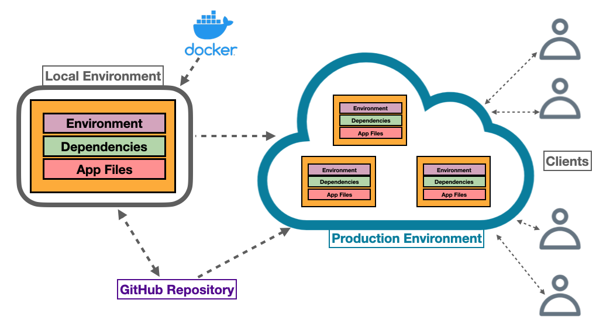

### Environment Setup

- Use [uv](https://docs.astral.sh/uv/) with Python 3.13 and the local [`pyproject.toml`](./pyproject.toml). It updates all packages from the course's `requirements.txt` and adds NumPy, pandas, Matplotlib, scikit-learn, python-dotenv (`import dotenv`), and Boto3.
- `pytest` is a development dependency, installed by default. Gunicorn is installed only on Unix systems; use Flask for local Windows exercises and Linux containers for Gunicorn.
- `uv.lock` records exact resolved versions. Keep it in version control; `.venv/` and `.env` are already ignored.

```powershell
# Run from this guide's repository root (PowerShell)
cd .../01_ServerDeployment

# Install Python 3.13 if needed, then create .venv and install locked dependencies
uv python install 3.13
uv sync --locked --python 3.13

# Run commands inside the environment without activating it
uv run python --version
uv run python lab/01_dockerfile_flask_app/app.py --port 8080
# Stop the app with Ctrl+C

# Optional: activate the environment to use python and pytest directly
.\.venv\Scripts\Activate.ps1
# In Bash on Linux/macOS/WSL: source .venv/bin/activate
# In Git Bash on Windows: source .venv/Scripts/activate
deactivate

# After intentionally editing dependencies, resolve and install the new versions
# uv lock
# uv sync --locked
# To refresh versions within the declared bounds: uv lock --upgrade
```

The upstream JWT exercise needs modernization with these dependencies: PyJWT 2.x returns a string from `jwt.encode()`, so remove `.decode('utf-8')` from the `/auth` response in `main.py` when adapting that exercise. The submodule and its old requirements are preserved. This environment does not change Docker builds; those use their own Dockerfile and dependency installation steps.

#### AWS CLI and Credentials

- The Python environment includes the PyPI `awscli` package (AWS CLI v1). For the SSO workflow below, install [AWS CLI v2](https://docs.aws.amazon.com/cli/latest/userguide/getting-started-install.html) separately and ensure it takes precedence on `PATH`. Boto3 is the Python SDK (Software Development Kit); it does not install the CLI.
- On this machine, CLI v2 is already installed at `C:\Program Files\Amazon\AWSCLIV2\aws.exe`. A broken Poetry-environment command currently shadows it on `PATH`; the commands below select the working installation for this terminal. If needed, fix the persistent Windows `PATH` order and reopen the terminal.
- Use a named profile such as `course`. For IAM (Identity and Access Management) Identity Center, use SSO (single sign-on); otherwise use the credentials supplied for the course or an IAM user. Boto3 uses the same profile and credential files. Keep credentials out of source files and Git.
  - SSO means Single Sign-On: you sign in through a central login system to access multiple applications or AWS accounts. **We should use the SSO for our everyday access instead of the root account.**
  - Sign in as root and enable MFA (multi-factor authentication).
  - Set up your everyday access through IAM Identity Center (SSO) or an IAM user.
    - We get a dedicated access URL: `https://<your-portal>.awsapps.com/start`
  - Sign out of root, then use that identity to create and manage resources.

To enable SSO:

```text
AWS Console (initial setup as root): https://console.aws.amazon.com
  Open: IAM Identity Center
  Select the region where Identity Center is configured
  Enable it if needed
    Use an organization instance with multi-account permissions

Left panel -> Users
  If no user exists -> Add user
    Enter username, email, and name
    Select the option to send an invitation email
    Accept the invitation and set a password

Left panel -> AWS accounts
  Select your AWS account
  Assign users or groups -> Users
    Select your existing/new user
  Select permission sets -> Create permission set
    Predefined permission set -> AdministratorAccess
    Session duration: 1 hour
    Relay state: leave blank
    Create
  Return to the assignment workflow
    Select AdministratorAccess
    Complete the assignment and wait for success

Dashboard -> Copy the AWS access portal URL: https://<your-portal>.awsapps.com/start
  Open it in a private browser window
  Sign in using your SSO credentials
  Your account should appear as Mikel / account ID
    Expand it -> AdministratorAccess -> Open AWS Console
  If no accounts appear:
    Confirm the user/account/permission-set assignment completed
    Sign out of the portal and sign back in

After confirming SSO access works:
  Sign out of the root console session
  Use the access portal for subsequent console sign-ins
    https://<your-portal>.awsapps.com/start
    Account > AdministratorAccess > Open AWS Console
```

To configure the CLI with the SSO authentication, follow the steps below:

```powershell
# Only if CLI v2 is missing: install using AWS's Windows installer, then reopen the terminal
# msiexec.exe /i https://awscli.amazonaws.com/AWSCLIV2.msi
# Alternative: install it via pip:
# uv pip install awscli --upgrade

# Check which aws commands Windows finds; prioritize CLI v2 in this terminal
Get-Command aws -All
$env:PATH = "C:\Program Files\Amazon\AWSCLIV2;" + $env:PATH
aws --version
# Expected prefix: aws-cli/2

# Choose ONE authentication method
# Opetion A: IAM Identity Center (requires your organization's SSO access details)
# One-time setup: saves the SSO settings as a local profile named course
# During setup, the CLI opens your browser.
# Sign in there with your SSO credentials and approve access
# ~/.aws/config: profile saved, portal URL, SSO region, account ID, role, and default region
# ~/.aws/sso/cache/: Cached SSO tokens
# ~/.aws/cli/cache/: Cached temporary role credentials
aws configure sso --profile deployment-course
# SSO session name (Recommended): deployment-course-sso
# SSO start URL [None]: https://<your-portal>.awsapps.com/start
# SSO region [None]: <your-sso-region>, e.g. eu-central-1
# SSO registration scopes [sso:account:access]: <ENTER>
# Web is opened, we log in with our SSO credentials and approve access
# After that, we can always log is as follows:
aws sso login --profile deployment-course
# Repeat the login command when the SSO session expires
# To log out:
# aws sso logout

# Verify access
aws sts get-caller-identity --profile deployment-course

# Option B: access keys supplied for your account/course, entered interactively
# aws configure --profile deployment-course
# For temporary credentials, also set the supplied session token interactively:
# aws configure set aws_session_token (Read-Host "Session token") --profile deployment-course
# Refresh all temporary credentials when they expire

# Select the same profile for CLI commands and Boto3 in this terminal
# And/or add it to .env
$env:AWS_PROFILE = "deployment-course"
# Bash equivalent: export AWS_PROFILE=deployment-course

# Choose your deployment region (example: Frankfurt) and JSON output
aws configure set region eu-central-1 --profile deployment-course
aws configure set output json --profile deployment-course

# Verify authentication; these commands do not create cloud resources
aws sts get-caller-identity --profile deployment-course
uv run python -c "import boto3; s = boto3.Session(profile_name='deployment-course'); print(s.client('sts').get_caller_identity()['Arn'])"
```

AWS stores profiles under `~/.aws/config` and access-key credentials under `~/.aws/credentials`. `python-dotenv` reads `.env` only when your application calls `load_dotenv()`; AWS tools do not automatically load that file. See the [AWS profile and SSO guide](https://docs.aws.amazon.com/cli/latest/userguide/cli-configure-sso.html).

Here, we use the SSO authentication to configure the AWS CLI. Later, in section [AWS CLI Configuration](#aws-cli-configuration) we see how to create a dedicated user to configure the AWS CLI, which is the best practice.

## Containers

I will summarize most of this section, since I know already the topic.
Check my notes on [Docker & Kubernetes](https://github.com/mxagar/tool_guides/blob/master/docker_swarm_kubernetes/docker_swarm_kubernetes_howto.md) if you are insterested.

### Introduction

Key concepts:

- Containers
  - App dependencies bundled.
  - Lightweight.
  - Share/use OS resources (1 kernel, shared libraries).
- Containers vs Virtual Machines (VM)
  - VMs: higher overhead; fully running OS, no sharing.
  - They use a *hypervisor*, which handles the access to OS infrastructure.
  - AWS EC2 creates VMs.
- Docker: Open Source Container Solution + Company selling products around that.
  - Install Docker on Linux / Mac / Windows.

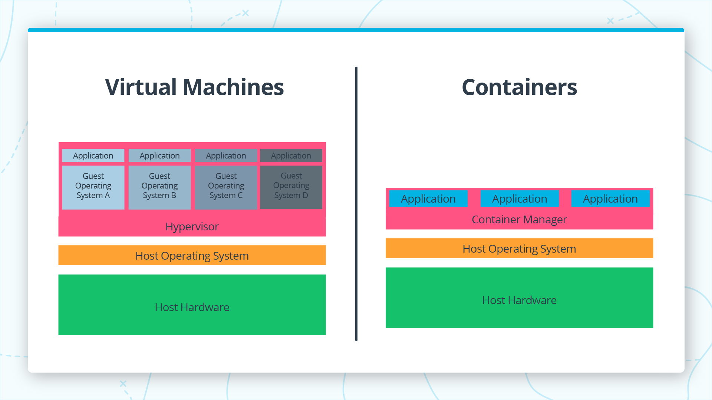

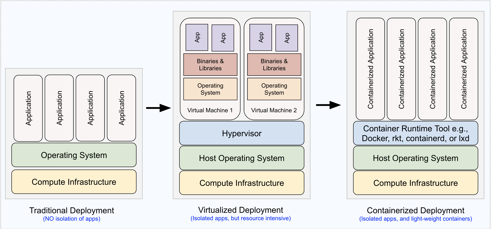

To check Docker installation:

```bash
# To check the version
docker version

# To verify that Docker can pull and run images
docker run hello-world 

# Run a container: open http://localhost:80
docker run -d -p 80:80 docker/getting-started
```

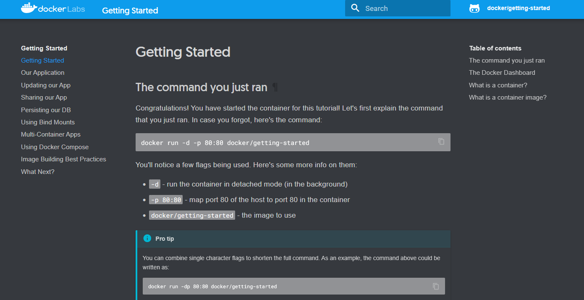

### Docker Concepts

Key concepts:

- Image: immutable template of the container
  - Images are created with Dockerfiles
  - We can have *base images*, which gather common *layers* used by several children images
- Container: running image instance
- Registry (e.g., Docker Hub): where docker images are stored
- Volumes: attached to containers, so that data persists, since containers a re ephemeral
- Network: communication network between containers
- Docker Engine: application which consistes of
  - Daemon: server that manages images, containers, networks, volumes
  - Client: UI for Docker, used often via CLI
  - API


```bash
# This command will look for a Dockerfile in the `pwd`, and create myImage
docker build  --tag myImage  [OPTIONS] path_where_to_store_the_image 

# We pull the public image tomcat (tag: latest)
docker pull tomcat:latest

# We run an image -> container
docker run --name myContainer myImage
```

### DockerHub Example: Pull and Run PostgreSQL

[DockerHub](https://hub.docker.com/) is the largest, public docker image registry.

```bash
# -- Get PostgreSQL image
docker pull postgres:latest

# -- Create and run container
# --name: name for container
# --e: environment variables
# --p: publish port
# --d: detach, run in the background and return terminal
docker run --name psql -e POSTGRES_PASSWORD=password! -p 5433:5432 -d postgres:latest

# -- Connect to the PostgreSQL container with psql; pw: password! (the one passed via -e)
psql -h 127.0.0.1 -p 5433 -U postgres
# In psql
\l  # list all databases
\dti  # list all tables and relations
# More psql commands: https://www.postgresql.org/docs/current/app-psql.html
\q  @ quit

# -- Clean up
# List all containers
docker ps --all
# Stop
docker stop <container_ID>
# Remove
docker container rm <container_ID>

# -- Images
# List all images
docker image ls
# Remove
docker image rm <image_ID>
```

### Dockerfiles

A `Dockerfile` is a text document that contains all the commands to assemble an image. It allows you to automate the image creation process.

Typical `Dockerfile` instructions:

```Dockerfile
# Base image
FROM python:3.13-slim

# Copy files from current directory to /app in the container
COPY . /app
# Set the working directory inside the container
WORKDIR /app

# RUN: run any shell command
RUN pip install --upgrade pip
RUN pip install flask

# ENTRYPOINT: set executable
# Assuming there is a Python script named app.py in the working directory
# and it accepts command-line arguments for configuration
ENTRYPOINT ["python", "app.py"]
# CMD: provide default arguments for the ENTRYPOINT
CMD ["--port", "8000"]
# Note: The CMD arguments can be overridden when running the container
# docker run myapp
# -> Runs: python app.py --port 8000
# docker run myapp --port 9000
# -> Runs: python app.py --port 9000
```

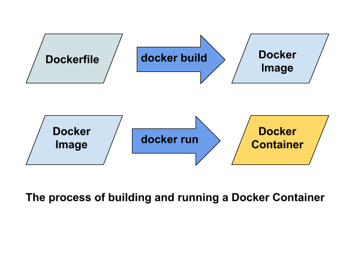

To build and run the Docker image:

```bash
# Build the image
docker build -t myapp .

# Run the container
docker run --name myapp_container -p 8000:8000 myapp
```

For more details and commans, check the [`Dockerfile` reference](https://docs.docker.com/reference/dockerfile/).

### Dockerfile Exercises

#### Simple Flask App

Files in [`lab/01_dockerfile_flask_app/`](./lab/01_dockerfile_flask_app/):

- `app.py`: The Flask application script.
- `Dockerfile`: The Dockerfile to build the Flask app image.

```python
from flask import Flask
import argparse

# Flask app instance
app = Flask(__name__)

# Parse command-line arguments for the Flask app
args = argparse.ArgumentParser()
args.add_argument('--port', type=int, default=8080)

@app.route('/')
def hello_world():
    return "Hello, World -- from Flask!"

if __name__ == '__main__':
    # Parse command-line arguments
    parsed_args = args.parse_args()
    port = parsed_args.port

    # Run Flask app
    app.run(host='0.0.0.0', port=port, debug=True)
```

```Dockerfile
# Base image
FROM python:3.13-slim

# Copy files from current directory to /app in the container
COPY . /app
# Set the working directory inside the container
WORKDIR /app

# RUN: run any shell command
RUN pip install --upgrade pip
RUN pip install flask

# ENTRYPOINT: set executable
# Assuming there is a Python script named app.py in the working directory
# and it accepts command-line arguments for configuration
ENTRYPOINT ["python", "app.py"]
# CMD: provide default arguments for the ENTRYPOINT
CMD ["--port", "8080"]
# Note: The CMD arguments can be overridden when running the container
# docker run myapp
# -> Runs: python app.py --port 8080
# docker run myapp --port 9000
# -> Runs: python app.py --port 9000
```

To build and run the Docker image:

```bash
cd .../lab/01_dockerfile_flask_app

# Build the image
docker build -t myapp .

# Run the container
docker run --name myapp_container --rm -p 8080:8080 myapp
# --rm: automatically remove the container when it exits

# List all containers (including stopped ones) + clean up
docker ps -a
docker container stop <container_ID>
docker container rm <container_ID>
```

#### Repository with More Exercises

The [Udacity course repository](https://github.com/udacity/cd0157-Server-Deployment-and-Containerization) provides more exercises in [`lab/udacity_server_deployment_exercises/`](./lab/udacity_server_deployment_exercises/), included as a Git submodule pinned to a specific commit.

This repository is included as a submodule in the `01_ServerDeployment/lab/udacity_server_deployment_exercises/` directory.

Here, basically the same example as before is demonstrated using the submodule's Flask application.

```bash
# Use the Flask example already included in this guide's submodule
cd .../lab/udacity_server_deployment_exercises/examples/flask

# Build an image named test; -t means --tag, and . is the build context
# Docker uses the Dockerfile in this directory by default
# The upstream example uses the old python:3.7.2-slim base image
# For a modernized exercise, change its FROM line to python:3.13-slim first
# Editing upstream files creates local changes inside the submodule
docker build -t test .
docker image ls

# Run the container; map host port 80 to Flask's container port 8080
# This runs in the foreground; use another terminal for the commands below
docker run --name myContainer -p 80:8080 test

# In another terminal: request the app, or open http://localhost:80/ in a browser
curl http://127.0.0.1:80/

# If port 80 is busy, use -p 9090:8080 instead, then visit http://localhost:9090/

# List running containers, then stop and remove this exercise's container
docker ps
docker stop myContainer
docker container rm myContainer

# Optional: remove the image after removing the container
docker image rm test

# Show help for container commands
docker container help
```

## AWS and Kubernetes

### Introduction to Kubernetes and Project Overview

- Docker packages an application with its environment and dependencies. Cloud deployment also requires managing how its container instances run and scale.
- **Container orchestration** manages containers across multiple hosts.
  - Creates and removes instances as needed; automatic scaling requires configuration.
  - Handles load balancing, health checks, configuration, networking, and container lifecycle management.
  - This course uses **Kubernetes** for orchestration.
- A **CI/CD (continuous integration and continuous delivery) pipeline** connects a shared code repository to the target infrastructure.
  - Typical steps: compile code when needed, run tests, build deployable artifacts, and deploy releases.
  - **Continuous integration (CI)** automatically builds and tests code changes outside production.
    - This course uses **AWS (Amazon Web Services) CodeBuild**; Jenkins is another option.
  - **Continuous delivery (CD)** keeps tested changes ready for release through an automated pipeline. Production deployment can require approval.
    - **Continuous deployment** also automates the production release without manual approval.
    - This course uses **AWS CodePipeline** to coordinate the release stages and support frequent, incremental releases.
- **Lesson objectives:**
  - Deploy a containerized application using **Amazon EKS (Elastic Kubernetes Service)**, AWS's managed Kubernetes service.
  - Set up continuous integration with AWS CodeBuild.
  - Create a continuous delivery pipeline with AWS CodePipeline.

The project uses these components:
- **Amazon EKS** for Kubernetes orchestration.
- **AWS CodeBuild** for continuous integration.
- **AWS CodePipeline** for continuous delivery.
- **Docker** for containerizing the application.
- **Flask** as the web application framework.

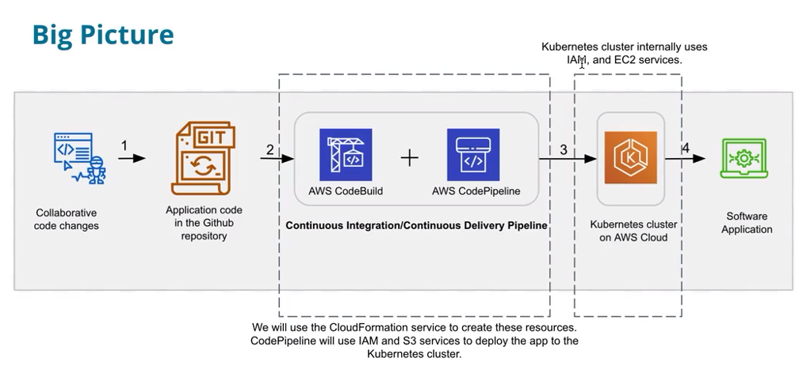

### AWS Resources and Cost

AWS Console: [https://console.aws.amazon.com](https://console.aws.amazon.com)

Contents:

- **AWS access setup**: how to sign in for course cloud work
- **Cost awareness**: AWS can incur charges if resources stay running; check [https://aws.amazon.com/pricing/](https://aws.amazon.com/pricing/).
  - Track costs: ` Billing and Cost Management > AWS Cost Explorer`.
- **Use course-provided resources**: follow the classroom instructions for credentials and access; we have a dedicated set of resources for the course (25 USD credits), accessible via `Cloud Resources`. We need to log out from any AWS accounts first.
- **Avoid surprise billing**: shut down or clean up services when you're done: EC2, Sagemaker, Database, EMR, CloudFormation.

However, I used my own AWS account for the course & the project.

### AWS Setup

AWS Console: [https://console.aws.amazon.com](https://console.aws.amazon.com)

Check section [AWS CLI and Credentials](#aws-cli-and-credentials).

Log in using AWS SSO:

```text
https://<your-portal>.awsapps.com/start
Account > AdministratorAccess > Open AWS Console
```

```bash
# In the Terminal, for AWS CLI:
aws sso login --profile deployment-course
# Repeat the login command when the SSO session expires
# To log out:
# aws sso logout

# Verify access
aws sts get-caller-identity --profile deployment-course

# Select the same profile for CLI commands and Boto3 in this terminal
# And/or add it to .env
$env:AWS_PROFILE = "deployment-course"
# Bash equivalent: export AWS_PROFILE=deployment-course
```

### S3: Create a Bucket

S3 = Simple Storage Service:

- To upload/download any files
- Organized in buckets
- We can define who can access the bucket contents
- There are different bucket classes: standard, intelligent-tiering, glacier, etc. (depending of expected access frequency and desired cost, etc.)

Log in using AWS SSO:

```text
https://<your-portal>.awsapps.com/start
Account > AdministratorAccess > Open AWS Console
```

Create a new S3 bucket via the web UI (i.e., teh AWS console):

```
AWS Console > S3 > Create bucket
  Bucket name: [<your-name>-]server-deployment[-<random-number>]
    It must be a unique name, we can attach a random number to it
  AWS Region: Frankfurt (eu-central-1) (or desired region)
  Block Public Access settings for this bucket:
    Uncheck "Block all public access"
    Acknowledge the warning
    Note: This allows public access to the bucket, so be cautious with sensitive data!
  Bucket Versioning: Disable
  Create bucket
  When created, click on bucket and we see we can upload objects
```

We can upload objects to the bucket:

- Go to the bucket, click on "Upload" and select the files you want to upload.
- The uploeaded objects get a unique URL.
- We can download & open the object in a browser from the web UI.
- Even though the we make the bucket public and the objects have a unique URL, we can use it from the outside if we explicitly make the object public: `Select Object: Object actions > Make public using ACL `. So a public bucket can contain public and non-public objects.
- We can also empty and delete the buckets via the web UI.

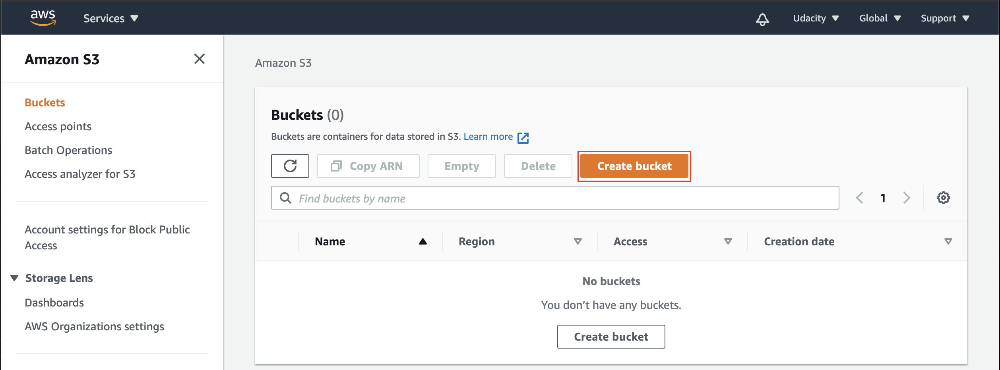

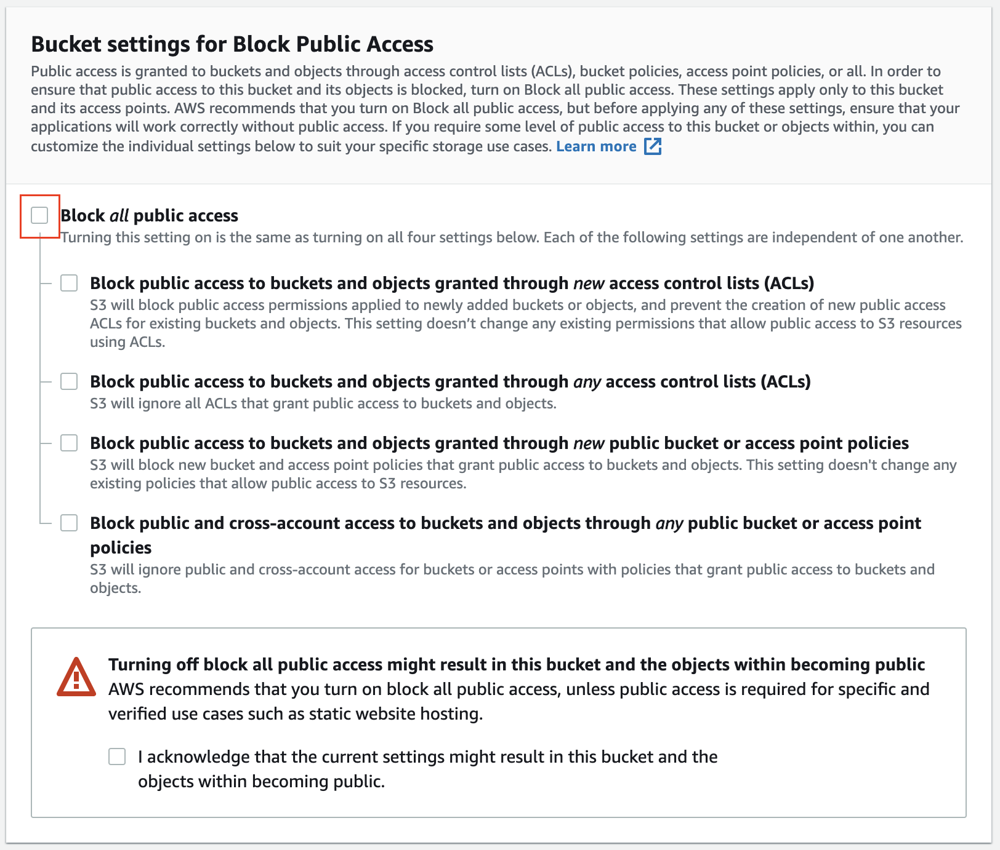

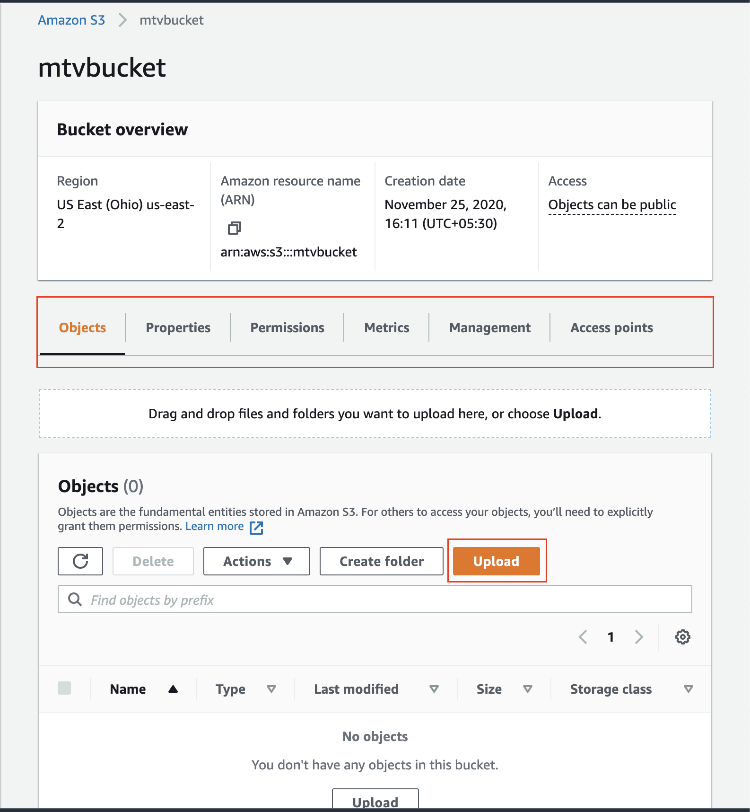

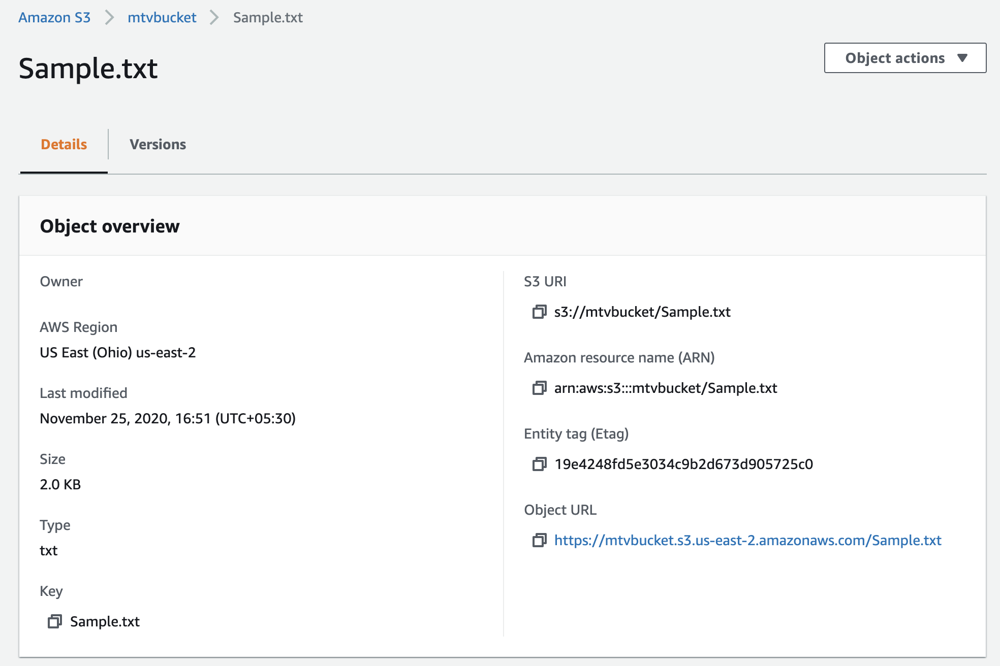


### Elastic Compute Cloud (EC2)

Elastic Compute Cloud = EC2

- Configurable Virtual Machines (VMs) in the cloud: we choose OS, CPU, RAM, etc.
- There are several pricing options:
  - Pay as you go = on-demand
  - Dedicated hosts = we don't share them
  - Spot instances = use spare capacity at a lower cost, but can be terminated by AWS with short notice
  - ...

Log in using AWS SSO:

```text
https://<your-portal>.awsapps.com/start
Account > AdministratorAccess > Open AWS Console
```

Create a new EC2 instance via the web UI (i.e., the AWS console):

```
AWS Console > EC2 > Launch Instance
  Name: [<your-name>-]server-deployment[-<random-number>]
  Choose an Amazon Machine Image (AMI): e.g., Amazon Linux 2
  Choose an Instance Type: e.g., t2.micro
    t2.micro is the smallest
  Key pair
    This allows us to securely connect to the instance via SSH using the key pair.
    If we don't have one, we can create a new key pair here.
    Create a new key pair:
      Key pair name: ...
      Choose: RAS / ED25519
      Choose: .pem (Mac/Linux) / .pkk (PuTTY)
    When created, download the private key file and keep it safe!
      The private key is downloaded: .pem
      The public key (.pub) is stored in AWS: ~/.ssh/authorized_keys
  Network settings
    Default network, no subnet, enable public IP
    Allow SSH from anywhere: 0.0.0.0/0º
  Add Storage: default settings
    8 GB pf gp2
  Add Tags: optional
  Configure Security Group: allow SSH (port 22) and HTTP (port 80)
  Review and Launch
  Launch Instance
```

Once created, we can go to the EC2 dashboard and click on it:

- We see the instance details, including its public IP address, DNS, instance ID, status, and other configuration information. Example:
  - Public IP: e.g., 2xx.xxx.xxx.xxx
  - Public DNS: e.g., ec2-2x.xxx.xxx.xxx.compute-1.amazonaws.com
  - Instance ID: e.g., i-xxx
  - Status: e.g., running
- We can also stop, start, reboot, or terminate the instance from the instance dashboard. Choose instance and then:
  - `Stop`: instance is stopped, but it still exists and can be started again. Watch out: even though an instance is stopped, we may still incur costs for attached storage.
  - `Terminate`: instance is permanently deleted and cannot be recovered; all associated resources are removed and no further costs should be incurred.
- If we click on `Connect`, we see the ways to connect to it:
  - **EC2 Instance Connect: connect directly from the browser**. Write `exit` to shut down the session.
  - **SSH client: connect from our machine using SSH with the private key we downloaded earlier (see below)**.
  - Session Manager: connect using AWS Systems Manager
  - EC2 Serial Console: connect using the EC2 Serial Console

We can connect to the EC2 instance using SSH:

```bash
# Restrict premissions
chmod 400 path/to/private-key.pem
# Connect to the instance using SSH: get the IP from the EC2 dashboard
ssh -i "path/to/your/private-key.pem" ubuntu@<instance-public-ip>
# Default user for Amazon Linux 2: ec2-user
```

### IAM Service

Identity and Access Management = IAM:

- **IAM** manages users, groups, roles, and permissions within an AWS account. **IAM Identity Center**, formerly AWS SSO (single sign-on), manages federated access to AWS accounts and applications.
- **IAM user:** an identity recognized by AWS services, representing a person, system, or application.
  - Can have a console password and long-term access keys for programmatic access.
  - Permissions come from policies attached directly or through groups; an authorized user can assume different roles.
- **IAM group:** a collection of IAM users with shared permissions. Attach or detach policies at group level to simplify access management.
- **IAM role:** an identity with permissions policies and a trust policy specifying who may assume it.
  - Authorized users, applications, or AWS services such as EC2 can assume a role.
  - Has no permanent password or access keys; assuming it provides temporary credentials for AWS requests.
  - Delegates access without sharing long-term keys. Prefer temporary role credentials for workloads and Identity Center access for people.
- **IAM policy:** a JSON (JavaScript Object Notation) document defining permissions.
  - `Effect`: whether a statement allows or denies access.
  - `Action`: permitted or denied operations, such as `s3:GetObject`.
  - `Resource`: resources to which the statement applies.
  - `Condition`: optional restrictions on when the statement applies.
  - AWS-managed policies are maintained by AWS; customer-managed policies are created and maintained in your account. A managed policy can be attached to multiple users, groups, or roles.
  - Apply **least privilege**: grant only the required actions on the required resources.
- **Validation:** use the [IAM policy simulator](https://policysim.aws.amazon.com/) to evaluate expected allowed and denied operations.
- **Further reading:** [Example IAM identity-based policies](https://docs.aws.amazon.com/IAM/latest/UserGuide/access_policies_examples.html), [IAM role versus IAM user discussion](https://stackoverflow.com/questions/46199680/difference-between-iam-role-and-iam-user-in-aws), and [AWS IAM FAQs](https://aws.amazon.com/iam/faqs/?nc=sn&loc=5).

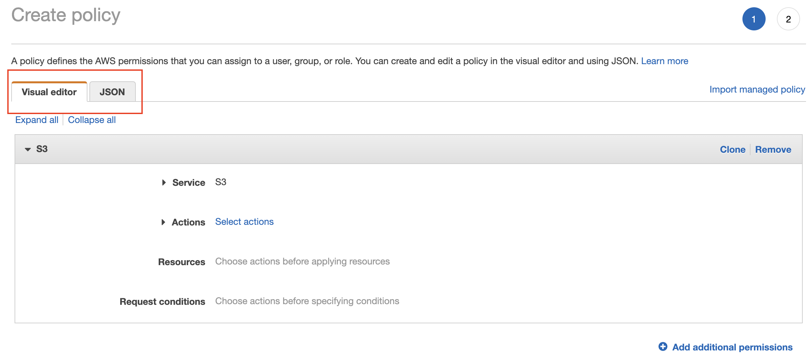

Example policy allowing all EC2 actions in `us-east-1`. EC2 (Elastic Compute Cloud) provides cloud virtual machines; the condition limits this statement's regional scope, and other applicable policies still affect effective permissions.

```json
{
    "Version": "2012-10-17",
    "Statement": [
        {
            "Action": "ec2:*",
            "Resource": "*",
            "Effect": "Allow",
            "Condition": {
                "StringEquals": {
                    "ec2:Region": "us-east-1"
                }
            }
        }
    ]
}
```

Log in using AWS SSO:

```text
https://<your-portal>.awsapps.com/start
Account > AdministratorAccess > Open AWS Console
```

Manage IAM via the web UI (i.e., the AWS console):

- The video creates a customer-managed policy named `myFirstPolicy` for S3 (Simple Storage Service).
- The visual editor groups actions into access levels such as List, Read, and Write. Expand a category to select individual operations; the final example selects only Read > GetObject.
- The demo uses any bucket and any object because no bucket exists yet. This wildcard also matches future buckets/objects; for real use, restrict it to the intended bucket or object prefix.
- Tags are optional key-value metadata for organizing resources. Reuse tag values across related resources; the demo skips tags and request conditions.

```text
AWS Console > Search: IAM > Dashboard
  Review counts of user groups, users, roles, and policies

Policies
  Browse existing AWS-managed and customer-managed policies
  Create policy > Visual editor
    Effect: Allow
    Service: S3
    Actions:
      Expand Read > select GetObject
      Leave other List, Read, and Write actions unselected
    Resources:
      The editor supports all resources or specific resource ARNs
      Demo: Specific > object > Add ARN > Any bucket + Any object
        ARN (Amazon Resource Name): arn:aws:s3:::*/*
      Preferred for a real bucket: arn:aws:s3:::<bucket-name>/*
    Request conditions: leave unset for the demo
  Next > Review and create
    Name: myFirstPolicy
    Description: Allow retrieving objects from any S3 bucket
    Tags: optional; skip for the demo
      Older console versions show a separate tags step
    Review the summary:
      Service: S3; access level: Read; action: GetObject
      Resource scope: all matching objects; no request conditions
  Create policy
  Return to Policies > search/filter for myFirstPolicy

Creating a policy alone does not grant access
  Attach it to the intended user, group, or role to use its permissions
```

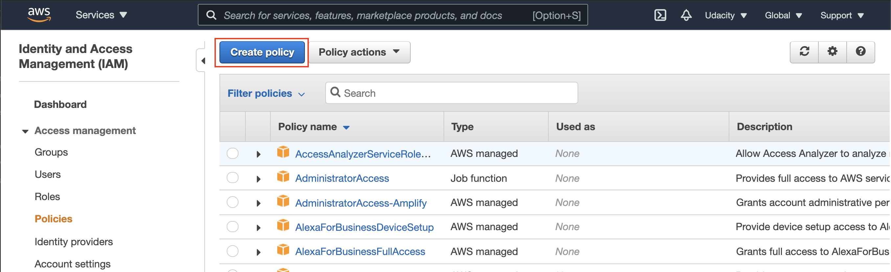

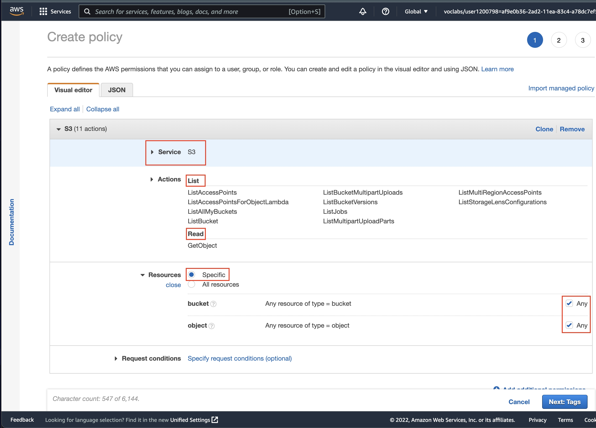

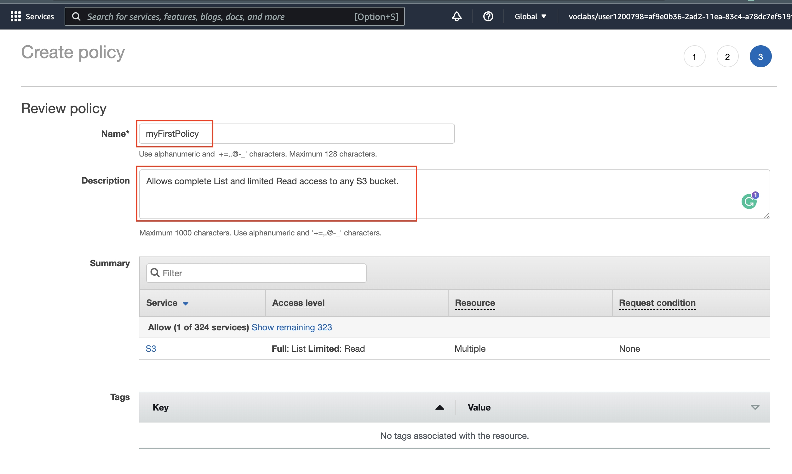

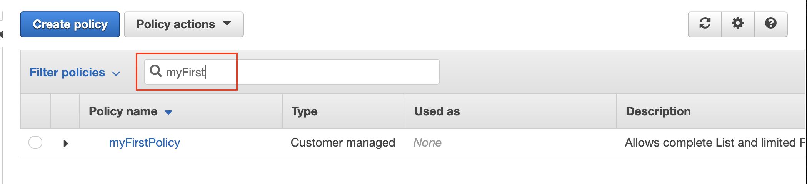

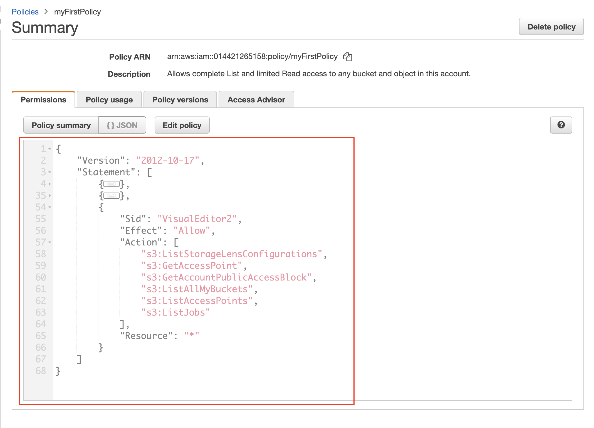

Equivalent JSON for the video's final selection:

```json
{
    "Version": "2012-10-17",
    "Statement": [
        {
            "Effect": "Allow",
            "Action": "s3:GetObject",
            "Resource": "arn:aws:s3:::*/*"
        }
    ]
}
```

This grants object retrieval, not bucket listing, uploads, or public access. Other applicable policies can still restrict access; the wildcard does not automatically grant access to other accounts' buckets.

### Extra: RDS

RDS = Relational Database Service:

- Managed relational databases, including PostgreSQL, MySQL, MariaDB, Oracle, and SQL Server. AWS manages the infrastructure, backups, and maintenance; you manage schemas, queries, and database access.
- For this lab, use **RDS for PostgreSQL**, a small **Single-AZ** instance, and minimal storage. Aurora PostgreSQL is a separate option and is unnecessary for this example.
  - Amazon Aurora is AWS’s database engine for applications that need higher availability and scalability.
- Costs include instance runtime, storage, and potentially backups and other features. Check the creation estimate and your account's credit/free-tier eligibility; do not assume the lab is free. See [RDS PostgreSQL pricing](https://aws.amazon.com/rds/postgresql/pricing/).

Log in using AWS SSO:

```text
https://<your-portal>.awsapps.com/start
Account > AdministratorAccess > Open AWS Console
```

Create PostgreSQL via the web UI (i.e., the AWS console):

```text
AWS Console > RDS > Databases > Create database
  Region: eu-central-1 (or the same region as your EC2 application)
  Creation method: Standard create
  Engine: PostgreSQL (not Aurora)
  Version: a currently supported version compatible with your application
  Template: Dev/Test or Free tier, if offered and eligible
  Availability: Single DB instance / Single-AZ
  DB instance identifier: deployment-course-db
  Credentials:
    Master username: postgres
    Self-managed password: generate a strong password and store it in your password manager
    Alternative: manage credentials with AWS Secrets Manager (additional charges apply)
  Instance class: Burstable > db.t4g.micro, if supported by your version/region
  Storage: General Purpose SSD (gp3), 20 GiB
    Disable storage autoscaling for this disposable lab to avoid unexpected growth
  Connectivity:
    VPC: same VPC (Virtual Private Cloud) as the EC2 application
    DB subnet group: subnets in at least two Availability Zones, even for Single-AZ
    Public access: No for an application running in the VPC
    VPC security group: dedicated group, e.g., deployment-course-db-sg
      Inbound: PostgreSQL / TCP 5432
      Source: the EC2 application's security group (not 0.0.0.0/0)
    Port: 5432
  Additional configuration:
    Initial database name: courseapp (otherwise connect to postgres first)
    Automated backup retention: 1 day for the lab; choose appropriately for real data
    Encryption: enabled
    Review optional monitoring/paid features before enabling them
    Deletion protection: disable only for this disposable exercise
  Review estimated cost > Create database
  Wait for status: Available
```

Connect to the database:

- Under **Databases > deployment-course-db > Connectivity & security**, copy the **endpoint hostname** and port. Use the endpoint rather than a fixed IP address.
- A private database is reachable from EC2 in the VPC, not directly from your laptop. SSH to EC2 first and run a PostgreSQL client there; install `postgresql-client` on Ubuntu if needed.
- For a temporary direct laptop connection, public access requires suitable public subnets/routes and a security-group rule allowing **only your current public IP `/32`** on port 5432. Remove this access afterward.
- SSO authenticates AWS management commands; it does not automatically authenticate SQL connections. Use database credentials here. Create a separate database user with limited permissions for your application.

```bash
# On an Ubuntu EC2 instance: install the PostgreSQL client if missing
sudo apt-get update
sudo apt-get install -y postgresql-client

# Download the AWS RDS certificate bundle to verify the server's identity
curl -o rds-global-bundle.pem https://truststore.pki.rds.amazonaws.com/global/global-bundle.pem

# Replace the endpoint; -W prompts for the password without putting it in shell history
psql "host=<rds-endpoint> port=5432 dbname=courseapp user=postgres sslmode=verify-full sslrootcert=rds-global-bundle.pem" -W

# Inside psql: check the connection, list databases/tables, then exit
\conninfo
\l
\dt
\q
```

Clean up via the console:

```text
RDS > Databases > Select deployment-course-db > Actions
  Stop temporarily: compute billing stops, but storage/backup charges remain
    RDS automatically restarts a stopped instance after 7 days
  Delete: permanently remove the disposable lab database
    Disable deletion protection first if enabled
    Final snapshot: keep for data you need; skip only for disposable data
    Retain automated backups: disable if no recovery is needed
    Acknowledge deletion and confirm
  Check Snapshots / retained automated backups for separately billed leftovers
  Remove the dedicated DB security group only when no resource uses it
```

See [connecting to RDS PostgreSQL](https://docs.aws.amazon.com/AmazonRDS/latest/UserGuide/USER_ConnectToPostgreSQLInstance.html) and [TLS certificate verification](https://docs.aws.amazon.com/AmazonRDS/latest/UserGuide/UsingWithRDS.SSL.html).

### AWS CLI Configuration

The [AWS CLI](https://aws.amazon.com/cli/) is a command-line tool that allows you to interact with AWS services directly from your terminal.

The section [AWS CLI and Credentials](#aws-cli-and-credentials) shows how to configure the AWS CLI with the SSO authentication. **Here, we will create a dedicated user with admin privileges for managing AWS resources via the CLI (programmatically).**

Some links:

- [AWS CLI commands reference](https://docs.aws.amazon.com/cli/latest/reference/)
- [Installing or updating to the latest version of the AWS CLI](https://docs.aws.amazon.com/cli/latest/userguide/install-cliv2.html)
- [Configuration basics](https://docs.aws.amazon.com/cli/latest/userguide/cli-configure-quickstart.html)
- [Configuration and credential file settings](https://docs.aws.amazon.com/cli/latest/userguide/cli-configure-files.html)
- [Environment variables to configure the AWS CLI](https://docs.aws.amazon.com/cli/latest/userguide/cli-configure-envvars.html)

To install or update the AWS CLI, run the following commands:

```bash
# Install or update the AWS CLI if needed
uv pip install --upgrade awscli

# See the current version
aws --version
# aws-cli/2.27.22 Python/3.13.3 Windows/11 exe/AMD64
```

#### Create an IAM User to Manage AWS Resources via CLI

#### Configure AWS CLI

#### Extra: IAM via AWS CLI

List users, policies, etc.
Add users, policies, etc.
Remove users, policies, etc.

#### Extra: S3 via AWS CLI

List S3 buckets, objects, etc.
Add S3 buckets, objects, etc.
Remove S3 buckets, objects, etc.
Make an object public, and revoke public access.

#### Extra: EC2 via AWS CLI

List EC2 instances, security groups, etc.
Add and Start EC2 instances, security groups, etc.
Stop and Remove EC2 instances, security groups, etc.

#### Extra: RDS via AWS CLI

List RDS instances, snapshots, security groups, etc.
Add RDS instances, snapshots, security groups, etc.
Remove RDS instances, snapshots, security groups, etc.
Access to RDS instance via CLI.

### Introduction to Kubernetes

### Kubernetes Concepts

### Kubernetes Components

### EKS: Amazon Elastic Kubernetes Service

## Deployment Using CI/CD

:construction:

## Project: Deploy Your Flask App to Kubernetes Using EKS

:construction:
