# Server Deployment and Containerization

These are my notes after following the Udacity course [Server Deployment and Containerization (Udacity Course)](https://www.udacity.com/course/server-deployment-and-containerization--cd0157).

See also my previous notes on [Docker & Kubernetes](https://github.com/mxagar/tool_guides/blob/master/docker_swarm_kubernetes/docker_swarm_kubernetes_howto.md).

The [Udacity course repository](https://github.com/udacity/cd0157-Server-Deployment-and-Containerization) is included as a Git submodule in [`lab/udacity_server_deployment_exercises/`](./lab/udacity_server_deployment_exercises/). It contains additional course exercises and is pinned to a specific upstream commit.

The submodule was added from this repository's root with:

```bash
git submodule add https://github.com/udacity/cd0157-Server-Deployment-and-Containerization.git 01_ServerDeployment/lab/udacity_server_deployment_exercises
```

To download the exercises after cloning this guide, run from the repository root:

```bash
git submodule update --init --recursive 01_ServerDeployment/lab/udacity_server_deployment_exercises
```

Alternatively, use `git clone --recurse-submodules <guide-repository-url>` when cloning this guide to download all its submodules.

Table of Contents:
- [Server Deployment and Containerization](#server-deployment-and-containerization)
  - [Introduction](#introduction)
    - [Container and Deployment Overview](#container-and-deployment-overview)
    - [Environment Setup](#environment-setup)
      - [AWS CLI and Credentials](#aws-cli-and-credentials)
  - [Containers](#containers)
    - [Introduction](#introduction-1)
    - [Docker Concepts](#docker-concepts)
    - [DockerHub Example: Pull and Run PostgreSQL](#dockerhub-example-pull-and-run-postgresql)
    - [Dockerfiles](#dockerfiles)
    - [Dockerfile Exercises](#dockerfile-exercises)
      - [Simple Flask App](#simple-flask-app)
      - [Repository with More Exercises](#repository-with-more-exercises)
  - [AWS and Kubernetes](#aws-and-kubernetes)
    - [Introduction to Kubernetes and Project Overview](#introduction-to-kubernetes-and-project-overview)
    - [AWS Resources and Cost](#aws-resources-and-cost)
    - [AWS Setup](#aws-setup)
    - [S3: Create a Bucket](#s3-create-a-bucket)
    - [Elastic Compute Cloud (EC2)](#elastic-compute-cloud-ec2)
    - [IAM Service](#iam-service)
    - [Extra: RDS](#extra-rds)
    - [AWS CLI Configuration](#aws-cli-configuration)
      - [Create an IAM User to Manage AWS Resources via CLI](#create-an-iam-user-to-manage-aws-resources-via-cli)
      - [Configure AWS CLI](#configure-aws-cli)
      - [S3 Management via AWS CLI](#s3-management-via-aws-cli)
      - [Extra: IAM Management via AWS CLI](#extra-iam-management-via-aws-cli)
      - [Extra: EC2 Management via AWS CLI](#extra-ec2-management-via-aws-cli)
      - [Extra: RDS Management via AWS CLI](#extra-rds-management-via-aws-cli)
    - [Introduction to Kubernetes](#introduction-to-kubernetes)
    - [Kubernetes Concepts](#kubernetes-concepts)
    - [Kubernetes Components](#kubernetes-components)
    - [EKS: Amazon Elastic Kubernetes Service](#eks-amazon-elastic-kubernetes-service)
    - [Creating an EKS Cluster via Web UI Console](#creating-an-eks-cluster-via-web-ui-console)
      - [Part 1: Prerequisites](#part-1-prerequisites)
      - [Part 2: Create the EKS Cluster](#part-2-create-the-eks-cluster)
      - [Part 3: Create a Node Group](#part-3-create-a-node-group)
      - [Part 4: Clean Up](#part-4-clean-up)
    - [Installing eksctl](#installing-eksctl)
      - [Prerequisites and AWS credentials](#prerequisites-and-aws-credentials)
      - [Install on Windows with PowerShell](#install-on-windows-with-powershell)
      - [Install on Linux](#install-on-linux)
      - [Install on macOS with Homebrew](#install-on-macos-with-homebrew)
      - [Create a basic cluster](#create-a-basic-cluster)
      - [Create a cluster from a YAML configuration](#create-a-cluster-from-a-yaml-configuration)
      - [List and delete clusters](#list-and-delete-clusters)
    - [Installing kubectl](#installing-kubectl)
      - [Install kubectl on Windows](#install-kubectl-on-windows)
      - [Install kubectl on Linux](#install-kubectl-on-linux)
      - [Install kubectl on macOS](#install-kubectl-on-macos)
      - [Configure kubectl to connect to EKS](#configure-kubectl-to-connect-to-eks)
      - [Inspect clusters, nodes, and Pods](#inspect-clusters-nodes-and-pods)
      - [Open a shell inside a Pod](#open-a-shell-inside-a-pod)
    - [Creating an EKS Cluster via eksctl and AWS CLI](#creating-an-eks-cluster-via-eksctl-and-aws-cli)
      - [Check the tools and AWS credentials](#check-the-tools-and-aws-credentials)
      - [Create the cluster](#create-the-cluster)
      - [Check the cluster and worker nodes](#check-the-cluster-and-worker-nodes)
      - [Delete the cluster when finished](#delete-the-cluster-when-finished)
  - [Deployment Using CI/CD: CloudFormation + CodeBuild + CodePipeline](#deployment-using-cicd-cloudformation--codebuild--codepipeline)
    - [Deploy a Flask Application Manually](#deploy-a-flask-application-manually)
      - [Prepare the Docker Hub repository and exercise files](#prepare-the-docker-hub-repository-and-exercise-files)
      - [Build and publish the image](#build-and-publish-the-image)
      - [Configure and apply the Kubernetes Deployment](#configure-and-apply-the-kubernetes-deployment)
      - [Understanding the Deployment YAML](#understanding-the-deployment-yaml)
      - [Access the application](#access-the-application)
      - [Troubleshoot and clean up](#troubleshoot-and-clean-up)
  - [Project: Deploy Your Flask App to Kubernetes Using EKS](#project-deploy-your-flask-app-to-kubernetes-using-eks)

## Introduction

Pre-requisites (knowledge in):

- HTML and CSS
- HTTP Requests and Routes
- RESTful APIs
- Identity and Access Management
- Python or Javascript Programming: Writing functions, logic, control flow
- Using the Terminal
- Version control in Git and using GitHub
- Relational databases and SQL
- Postgres SQL
- Object-Relational Mappers with SQLAlchemy

### Container and Deployment Overview

> - A container is a running piece of software that bundles code along with all of its dependencies, including system tools, libraries, or configuration files. We use [Docker](https://www.docker.com/) to create containers.
> - [Kubernetes](https://kubernetes.io/) is a container orchestration system that automates container deployment, scaling, and management and will be used in this course.


### Environment Setup

- Use [uv](https://docs.astral.sh/uv/) with Python 3.13 and the local [`pyproject.toml`](./pyproject.toml). It updates all packages from the course's `requirements.txt` and adds NumPy, pandas, Matplotlib, scikit-learn, python-dotenv (`import dotenv`), and Boto3.
- `pytest` is a development dependency, installed by default. Gunicorn is installed only on Unix systems; use Flask for local Windows exercises and Linux containers for Gunicorn.
- `uv.lock` records exact resolved versions. Keep it in version control; `.venv/` and `.env` are already ignored.

```powershell
# Run from this guide's repository root (PowerShell)
cd .../01_ServerDeployment

# Install Python 3.13 if needed, then create .venv and install locked dependencies
uv python install 3.13
uv sync --locked --python 3.13

# Run commands inside the environment without activating it
uv run python --version
uv run python lab/01_dockerfile_flask_app/app.py --port 8080
# Stop the app with Ctrl+C

# Optional: activate the environment to use python and pytest directly
.\.venv\Scripts\Activate.ps1
# In Bash on Linux/macOS/WSL: source .venv/bin/activate
# In Git Bash on Windows: source .venv/Scripts/activate
deactivate

# After intentionally editing dependencies, resolve and install the new versions
# uv lock
# uv sync --locked
# To refresh versions within the declared bounds: uv lock --upgrade
```

The upstream JWT exercise needs modernization with these dependencies: PyJWT 2.x returns a string from `jwt.encode()`, so remove `.decode('utf-8')` from the `/auth` response in `main.py` when adapting that exercise. The submodule and its old requirements are preserved. This environment does not change Docker builds; those use their own Dockerfile and dependency installation steps.

#### AWS CLI and Credentials

- The Python environment includes the PyPI `awscli` package (AWS CLI v1). For the SSO workflow below, install [AWS CLI v2](https://docs.aws.amazon.com/cli/latest/userguide/getting-started-install.html) separately and ensure it takes precedence on `PATH`. Boto3 is the Python SDK (Software Development Kit); it does not install the CLI.
- On this machine, CLI v2 is already installed at `C:\Program Files\Amazon\AWSCLIV2\aws.exe`. A broken Poetry-environment command currently shadows it on `PATH`; the commands below select the working installation for this terminal. If needed, fix the persistent Windows `PATH` order and reopen the terminal.
- Use a named profile such as `course`. For IAM (Identity and Access Management) Identity Center, use SSO (single sign-on); otherwise use the credentials supplied for the course or an IAM user. Boto3 uses the same profile and credential files. Keep credentials out of source files and Git.
  - SSO means Single Sign-On: you sign in through a central login system to access multiple applications or AWS accounts. **We should use the SSO for our everyday access instead of the root account.**
  - Sign in as root and enable MFA (multi-factor authentication).
  - Set up your everyday access through IAM Identity Center (SSO) or an IAM user.
    - We get a dedicated access URL: `https://<your-portal>.awsapps.com/start`
  - Sign out of root, then use that identity to create and manage resources.

To enable SSO:

```text
AWS Console (initial setup as root): https://console.aws.amazon.com
  Open: IAM Identity Center
  Select the region where Identity Center is configured
  Enable it if needed
    Use an organization instance with multi-account permissions

Left panel -> Users
  If no user exists -> Add user
    Enter username, email, and name
    Select the option to send an invitation email
    Accept the invitation and set a password

Left panel -> AWS accounts
  Select your AWS account
  Assign users or groups -> Users
    Select your existing/new user
  Select permission sets -> Create permission set
    Predefined permission set -> AdministratorAccess
    Session duration: 1 hour
    Relay state: leave blank
    Create
  Return to the assignment workflow
    Select AdministratorAccess
    Complete the assignment and wait for success

Dashboard -> Copy the AWS access portal URL: https://<your-portal>.awsapps.com/start
  Open it in a private browser window
  Sign in using your SSO credentials
  Your account should appear as Mikel / account ID
    Expand it -> AdministratorAccess -> Open AWS Console
  If no accounts appear:
    Confirm the user/account/permission-set assignment completed
    Sign out of the portal and sign back in

After confirming SSO access works:
  Sign out of the root console session
  Use the access portal for subsequent console sign-ins
    https://<your-portal>.awsapps.com/start
    Account > AdministratorAccess > Open AWS Console
```

To configure the CLI with the SSO authentication, follow the steps below:

```powershell
# Only if CLI v2 is missing: install using AWS's Windows installer, then reopen the terminal
# msiexec.exe /i https://awscli.amazonaws.com/AWSCLIV2.msi
# Alternative: install it via pip:
# uv pip install awscli --upgrade

# Check which aws commands Windows finds; prioritize CLI v2 in this terminal
Get-Command aws -All
$env:PATH = "C:\Program Files\Amazon\AWSCLIV2;" + $env:PATH
aws --version
# Expected prefix: aws-cli/2

# Choose ONE authentication method
# Opetion A: IAM Identity Center (requires your organization's SSO access details)
# One-time setup: saves the SSO settings as a local profile named course
# During setup, the CLI opens your browser.
# Sign in there with your SSO credentials and approve access
# ~/.aws/config: profile saved, portal URL, SSO region, account ID, role, and default region
# ~/.aws/sso/cache/: Cached SSO tokens
# ~/.aws/cli/cache/: Cached temporary role credentials
aws configure sso --profile deployment-course
# SSO session name (Recommended): deployment-course-sso
# SSO start URL [None]: https://<your-portal>.awsapps.com/start
# SSO region [None]: <your-sso-region>, e.g. eu-central-1
# SSO registration scopes [sso:account:access]: <ENTER>
# Web is opened, we log in with our SSO credentials and approve access
# After that, we can always log is as follows:
aws sso login --profile deployment-course
# Repeat the login command when the SSO session expires
# To log out:
# aws sso logout

# Verify access
aws sts get-caller-identity --profile deployment-course

# Option B: access keys supplied for your account/course, entered interactively
# aws configure --profile deployment-course
# For temporary credentials, also set the supplied session token interactively:
# aws configure set aws_session_token (Read-Host "Session token") --profile deployment-course
# Refresh all temporary credentials when they expire

# Select the same profile for CLI commands and Boto3 in this terminal
# And/or add it to .env
$env:AWS_PROFILE = "deployment-course"
# Bash equivalent: export AWS_PROFILE=deployment-course

# Choose your deployment region (example: Frankfurt) and JSON output
aws configure set region eu-central-1 --profile deployment-course
aws configure set output json --profile deployment-course

# Verify authentication; these commands do not create cloud resources
aws sts get-caller-identity --profile deployment-course
uv run python -c "import boto3; s = boto3.Session(profile_name='deployment-course'); print(s.client('sts').get_caller_identity()['Arn'])"
```

AWS stores profiles under `~/.aws/config` and access-key credentials under `~/.aws/credentials`. `python-dotenv` reads `.env` only when your application calls `load_dotenv()`; AWS tools do not automatically load that file. See the [AWS profile and SSO guide](https://docs.aws.amazon.com/cli/latest/userguide/cli-configure-sso.html).

Here, we use the SSO authentication to configure the AWS CLI. Later, in section [AWS CLI Configuration](#aws-cli-configuration) we see how to create a dedicated user to configure the AWS CLI, which is the best practice.

## Containers

I will summarize most of this section, since I know already the topic.
Check my notes on [Docker & Kubernetes](https://github.com/mxagar/tool_guides/blob/master/docker_swarm_kubernetes/docker_swarm_kubernetes_howto.md) if you are insterested.

### Introduction

Key concepts:

- Containers
  - App dependencies bundled.
  - Lightweight.
  - Share/use OS resources (1 kernel, shared libraries).
- Containers vs Virtual Machines (VM)
  - VMs: higher overhead; fully running OS, no sharing.
  - They use a *hypervisor*, which handles the access to OS infrastructure.
  - AWS EC2 creates VMs.
- Docker: Open Source Container Solution + Company selling products around that.
  - Install Docker on Linux / Mac / Windows.


To check Docker installation:

```bash
# To check the version
docker version

# To verify that Docker can pull and run images
docker run hello-world 

# Run a container: open http://localhost:80
docker run -d -p 80:80 docker/getting-started
```


### Docker Concepts

Key concepts:

- Image: immutable template of the container
  - Images are created with Dockerfiles
  - We can have *base images*, which gather common *layers* used by several children images
- Container: running image instance
- Registry (e.g., Docker Hub): where docker images are stored
- Volumes: attached to containers, so that data persists, since containers a re ephemeral
- Network: communication network between containers
- Docker Engine: application which consistes of
  - Daemon: server that manages images, containers, networks, volumes
  - Client: UI for Docker, used often via CLI
  - API


```bash
# This command will look for a Dockerfile in the `pwd`, and create myImage
docker build  --tag myImage  [OPTIONS] path_where_to_store_the_image 

# We pull the public image tomcat (tag: latest)
docker pull tomcat:latest

# We run an image -> container
docker run --name myContainer myImage
```

### DockerHub Example: Pull and Run PostgreSQL

[DockerHub](https://hub.docker.com/) is the largest, public docker image registry.

```bash
# -- Get PostgreSQL image
docker pull postgres:latest

# -- Create and run container
# --name: name for container
# --e: environment variables
# --p: publish port
# --d: detach, run in the background and return terminal
docker run --name psql -e POSTGRES_PASSWORD=password! -p 5433:5432 -d postgres:latest

# -- Connect to the PostgreSQL container with psql; pw: password! (the one passed via -e)
psql -h 127.0.0.1 -p 5433 -U postgres
# In psql
\l  # list all databases
\dti  # list all tables and relations
# More psql commands: https://www.postgresql.org/docs/current/app-psql.html
\q  @ quit

# -- Clean up
# List all containers
docker ps --all
# Stop
docker stop <container_ID>
# Remove
docker container rm <container_ID>

# -- Images
# List all images
docker image ls
# Remove
docker image rm <image_ID>
```

### Dockerfiles

A `Dockerfile` is a text document that contains all the commands to assemble an image. It allows you to automate the image creation process.

Typical `Dockerfile` instructions:

```Dockerfile
# Base image
FROM python:3.13-slim

# Copy files from current directory to /app in the container
COPY . /app
# Set the working directory inside the container
WORKDIR /app

# RUN: run any shell command
RUN pip install --upgrade pip
RUN pip install flask

# ENTRYPOINT: set executable
# Assuming there is a Python script named app.py in the working directory
# and it accepts command-line arguments for configuration
ENTRYPOINT ["python", "app.py"]
# CMD: provide default arguments for the ENTRYPOINT
CMD ["--port", "8000"]
# Note: The CMD arguments can be overridden when running the container
# docker run myapp
# -> Runs: python app.py --port 8000
# docker run myapp --port 9000
# -> Runs: python app.py --port 9000
```


To build and run the Docker image:

```bash
# Build the image
docker build -t myapp .

# Run the container
docker run --name myapp_container -p 8000:8000 myapp
```

For more details and commans, check the [`Dockerfile` reference](https://docs.docker.com/reference/dockerfile/).

### Dockerfile Exercises

#### Simple Flask App

Files in [`lab/01_dockerfile_flask_app/`](./lab/01_dockerfile_flask_app/):

- `app.py`: The Flask application script.
- `Dockerfile`: The Dockerfile to build the Flask app image.

```python
from flask import Flask
import argparse

# Flask app instance
app = Flask(__name__)

# Parse command-line arguments for the Flask app
args = argparse.ArgumentParser()
args.add_argument('--port', type=int, default=8080)

@app.route('/')
def hello_world():
    return "Hello, World -- from Flask!"

if __name__ == '__main__':
    # Parse command-line arguments
    parsed_args = args.parse_args()
    port = parsed_args.port

    # Run Flask app
    app.run(host='0.0.0.0', port=port, debug=True)
```

```Dockerfile
# Base image
FROM python:3.13-slim

# Copy files from current directory to /app in the container
COPY . /app
# Set the working directory inside the container
WORKDIR /app

# RUN: run any shell command
RUN pip install --upgrade pip
RUN pip install flask

# ENTRYPOINT: set executable
# Assuming there is a Python script named app.py in the working directory
# and it accepts command-line arguments for configuration
ENTRYPOINT ["python", "app.py"]
# CMD: provide default arguments for the ENTRYPOINT
CMD ["--port", "8080"]
# Note: The CMD arguments can be overridden when running the container
# docker run myapp
# -> Runs: python app.py --port 8080
# docker run myapp --port 9000
# -> Runs: python app.py --port 9000
```

To build and run the Docker image:

```bash
cd .../lab/01_dockerfile_flask_app

# Build the image
docker build -t myapp .

# Run the container
docker run --name myapp_container --rm -p 8080:8080 myapp
# --rm: automatically remove the container when it exits

# List all containers (including stopped ones) + clean up
docker ps -a
docker container stop <container_ID>
docker container rm <container_ID>
```

#### Repository with More Exercises

The [Udacity course repository](https://github.com/udacity/cd0157-Server-Deployment-and-Containerization) provides more exercises in [`lab/udacity_server_deployment_exercises/`](./lab/udacity_server_deployment_exercises/), included as a Git submodule pinned to a specific commit.

This repository is included as a submodule in the `01_ServerDeployment/lab/udacity_server_deployment_exercises/` directory.

Here, basically the same example as before is demonstrated using the submodule's Flask application.

```bash
# Use the Flask example already included in this guide's submodule
cd .../lab/udacity_server_deployment_exercises/examples/flask

# Build an image named test; -t means --tag, and . is the build context
# Docker uses the Dockerfile in this directory by default
# The upstream example uses the old python:3.7.2-slim base image
# For a modernized exercise, change its FROM line to python:3.13-slim first
# Editing upstream files creates local changes inside the submodule
docker build -t test .
docker image ls

# Run the container; map host port 80 to Flask's container port 8080
# This runs in the foreground; use another terminal for the commands below
docker run --name myContainer -p 80:8080 test

# In another terminal: request the app, or open http://localhost:80/ in a browser
curl http://127.0.0.1:80/

# If port 80 is busy, use -p 9090:8080 instead, then visit http://localhost:9090/

# List running containers, then stop and remove this exercise's container
docker ps
docker stop myContainer
docker container rm myContainer

# Optional: remove the image after removing the container
docker image rm test

# Show help for container commands
docker container help
```

## AWS and Kubernetes

### Introduction to Kubernetes and Project Overview

- Docker packages an application with its environment and dependencies. Cloud deployment also requires managing how its container instances run and scale.
- **Container orchestration** manages containers across multiple hosts.
  - Creates and removes instances as needed; automatic scaling requires configuration.
  - Handles load balancing, health checks, configuration, networking, and container lifecycle management.
  - This course uses **Kubernetes** for orchestration.
- A **CI/CD (continuous integration and continuous delivery) pipeline** connects a shared code repository to the target infrastructure.
  - Typical steps: compile code when needed, run tests, build deployable artifacts, and deploy releases.
  - **Continuous integration (CI)** automatically builds and tests code changes outside production.
    - This course uses **AWS (Amazon Web Services) CodeBuild**; Jenkins is another option.
  - **Continuous delivery (CD)** keeps tested changes ready for release through an automated pipeline. Production deployment can require approval.
    - **Continuous deployment** also automates the production release without manual approval.
    - This course uses **AWS CodePipeline** to coordinate the release stages and support frequent, incremental releases.
- **Lesson objectives:**
  - Deploy a containerized application using **Amazon EKS (Elastic Kubernetes Service)**, AWS's managed Kubernetes service.
  - Set up continuous integration with AWS CodeBuild.
  - Create a continuous delivery pipeline with AWS CodePipeline.

The project uses these components:
- **Amazon EKS** for Kubernetes orchestration.
- **AWS CodeBuild** for continuous integration.
- **AWS CodePipeline** for continuous delivery.
- **Docker** for containerizing the application.
- **Flask** as the web application framework.


### AWS Resources and Cost

AWS Console: [https://console.aws.amazon.com](https://console.aws.amazon.com)

Contents:

- **AWS access setup**: how to sign in for course cloud work
- **Cost awareness**: AWS can incur charges if resources stay running; check [https://aws.amazon.com/pricing/](https://aws.amazon.com/pricing/).
  - Track costs: ` Billing and Cost Management > AWS Cost Explorer`.
- **Use course-provided resources**: follow the classroom instructions for credentials and access; we have a dedicated set of resources for the course (25 USD credits), accessible via `Cloud Resources`. We need to log out from any AWS accounts first.
- **Avoid surprise billing**: shut down or clean up services when you're done: EC2, Sagemaker, Database, EMR, CloudFormation.

However, I used my own AWS account for the course & the project.

### AWS Setup

AWS Console: [https://console.aws.amazon.com](https://console.aws.amazon.com)

Check section [AWS CLI and Credentials](#aws-cli-and-credentials).

Log in using AWS SSO:

```text
https://<your-portal>.awsapps.com/start
Account > AdministratorAccess > Open AWS Console
```

```bash
# In the Terminal, for AWS CLI:
$env:PATH = "C:\Program Files\Amazon\AWSCLIV2;" + $env:PATH
aws sso login --profile deployment-course
# Repeat the login command when the SSO session expires
# To log out:
# aws sso logout

# Verify access
aws sts get-caller-identity --profile deployment-course

# Select the same profile for CLI commands and Boto3 in this terminal
# And/or add it to .env
$env:AWS_PROFILE = "deployment-course"
# Bash equivalent: export AWS_PROFILE=deployment-course
```

### S3: Create a Bucket

S3 = Simple Storage Service:

- To upload/download any files
- Organized in buckets
- We can define who can access the bucket contents
- There are different bucket classes: standard, intelligent-tiering, glacier, etc. (depending of expected access frequency and desired cost, etc.)

Log in using AWS SSO:

```text
https://<your-portal>.awsapps.com/start
Account > AdministratorAccess > Open AWS Console
```

Create a new S3 bucket via the web UI (i.e., teh AWS console):

```
AWS Console > S3 > Create bucket
  Bucket name: [<your-name>-]server-deployment[-<random-number>]
    It must be a unique name, we can attach a random number to it
  AWS Region: Frankfurt (eu-central-1) (or desired region)
  Block Public Access settings for this bucket:
    Uncheck "Block all public access"
    Acknowledge the warning
    Note: This allows public access to the bucket, so be cautious with sensitive data!
  Bucket Versioning: Disable
  Create bucket
  When created, click on bucket and we see we can upload objects
```

We can upload objects to the bucket:

- Go to the bucket, click on "Upload" and select the files you want to upload.
- The uploeaded objects get a unique URL.
- We can download & open the object in a browser from the web UI.
- Even though the we make the bucket public and the objects have a unique URL, we can use it from the outside if we explicitly make the object public: `Select Object: Object actions > Make public using ACL `. So a public bucket can contain public and non-public objects.
- We can also empty and delete the buckets via the web UI.


### Elastic Compute Cloud (EC2)

Elastic Compute Cloud = EC2

- Configurable Virtual Machines (VMs) in the cloud: we choose OS, CPU, RAM, etc.
- There are several pricing options:
  - Pay as you go = on-demand
  - Dedicated hosts = we don't share them
  - Spot instances = use spare capacity at a lower cost, but can be terminated by AWS with short notice
  - ...

Log in using AWS SSO:

```text
https://<your-portal>.awsapps.com/start
Account > AdministratorAccess > Open AWS Console
```

Create a new EC2 instance via the web UI (i.e., the AWS console):

```
AWS Console > EC2 > Launch Instance
  Name: [<your-name>-]server-deployment[-<random-number>]
  Choose an Amazon Machine Image (AMI): e.g., Amazon Linux 2
  Choose an Instance Type: e.g., t2.micro
    t2.micro is the smallest
  Key pair
    This allows us to securely connect to the instance via SSH using the key pair.
    If we don't have one, we can create a new key pair here.
    Create a new key pair:
      Key pair name: ...
      Choose: RAS / ED25519
      Choose: .pem (Mac/Linux) / .pkk (PuTTY)
    When created, download the private key file and keep it safe!
      The private key is downloaded: .pem
      The public key (.pub) is stored in AWS: ~/.ssh/authorized_keys
  Network settings
    Default network, no subnet, enable public IP
    Allow SSH from anywhere: 0.0.0.0/0º
  Add Storage: default settings
    8 GB pf gp2
  Add Tags: optional
  Configure Security Group: allow SSH (port 22) and HTTP (port 80)
  Review and Launch
  Launch Instance
```

Once created, we can go to the EC2 dashboard and click on it:

- We see the instance details, including its public IP address, DNS, instance ID, status, and other configuration information. Example:
  - Public IP: e.g., 2xx.xxx.xxx.xxx
  - Public DNS: e.g., ec2-2x.xxx.xxx.xxx.compute-1.amazonaws.com
  - Instance ID: e.g., i-xxx
  - Status: e.g., running
- We can also stop, start, reboot, or terminate the instance from the instance dashboard. Choose instance and then:
  - `Stop`: instance is stopped, but it still exists and can be started again. Watch out: even though an instance is stopped, we may still incur costs for attached storage.
  - `Terminate`: instance is permanently deleted and cannot be recovered; all associated resources are removed and no further costs should be incurred.
- If we click on `Connect`, we see the ways to connect to it:
  - **EC2 Instance Connect: connect directly from the browser**. Write `exit` to shut down the session.
  - **SSH client: connect from our machine using SSH with the private key we downloaded earlier (see below)**.
  - Session Manager: connect using AWS Systems Manager
  - EC2 Serial Console: connect using the EC2 Serial Console

We can connect to the EC2 instance using SSH:

```bash
# Restrict premissions
chmod 400 path/to/private-key.pem
# Connect to the instance using SSH: get the IP from the EC2 dashboard
ssh -i "path/to/your/private-key.pem" ubuntu@<instance-public-ip>
# Default user for Amazon Linux 2: ec2-user
```

### IAM Service

Identity and Access Management = IAM:

- **IAM** manages users, groups, roles, and permissions within an AWS account. **IAM Identity Center**, formerly AWS SSO (single sign-on), manages federated access to AWS accounts and applications.
- **IAM user:** an identity recognized by AWS services, representing a person, system, or application.
  - Can have a console password and long-term access keys for programmatic access.
  - Permissions come from policies attached directly or through groups; an authorized user can assume different roles.
- **IAM group:** a collection of IAM users with shared permissions. Attach or detach policies at group level to simplify access management.
- **IAM role:** an identity with permissions policies and a trust policy specifying who may assume it.
  - Authorized users, applications, or AWS services such as EC2 can assume a role.
  - Has no permanent password or access keys; assuming it provides temporary credentials for AWS requests.
  - Delegates access without sharing long-term keys. Prefer temporary role credentials for workloads and Identity Center access for people.
- **IAM policy:** a JSON (JavaScript Object Notation) document defining permissions.
  - `Effect`: whether a statement allows or denies access.
  - `Action`: permitted or denied operations, such as `s3:GetObject`.
  - `Resource`: resources to which the statement applies.
  - `Condition`: optional restrictions on when the statement applies.
  - AWS-managed policies are maintained by AWS; customer-managed policies are created and maintained in your account. A managed policy can be attached to multiple users, groups, or roles.
  - Apply **least privilege**: grant only the required actions on the required resources.
- **Validation:** use the [IAM policy simulator](https://policysim.aws.amazon.com/) to evaluate expected allowed and denied operations.
- **Further reading:** [Example IAM identity-based policies](https://docs.aws.amazon.com/IAM/latest/UserGuide/access_policies_examples.html), [IAM role versus IAM user discussion](https://stackoverflow.com/questions/46199680/difference-between-iam-role-and-iam-user-in-aws), and [AWS IAM FAQs](https://aws.amazon.com/iam/faqs/?nc=sn&loc=5).


Example policy allowing all EC2 actions in `us-east-1`. EC2 (Elastic Compute Cloud) provides cloud virtual machines; the condition limits this statement's regional scope, and other applicable policies still affect effective permissions.

```json
{
    "Version": "2012-10-17",
    "Statement": [
        {
            "Action": "ec2:*",
            "Resource": "*",
            "Effect": "Allow",
            "Condition": {
                "StringEquals": {
                    "ec2:Region": "us-east-1"
                }
            }
        }
    ]
}
```

Log in using AWS SSO:

```text
https://<your-portal>.awsapps.com/start
Account > AdministratorAccess > Open AWS Console
```

Manage IAM via the web UI (i.e., the AWS console):

- The video creates a customer-managed policy named `myFirstPolicy` for S3 (Simple Storage Service).
- The visual editor groups actions into access levels such as List, Read, and Write. Expand a category to select individual operations; the final example selects only Read > GetObject.
- The demo uses any bucket and any object because no bucket exists yet. This wildcard also matches future buckets/objects; for real use, restrict it to the intended bucket or object prefix.
- Tags are optional key-value metadata for organizing resources. Reuse tag values across related resources; the demo skips tags and request conditions.

```text
AWS Console > Search: IAM > Dashboard
  Review counts of user groups, users, roles, and policies

Policies
  Browse existing AWS-managed and customer-managed policies
  Create policy > Visual editor
    Effect: Allow
    Service: S3
    Actions:
      Expand Read > select GetObject
      Leave other List, Read, and Write actions unselected
    Resources:
      The editor supports all resources or specific resource ARNs
      Demo: Specific > object > Add ARN > Any bucket + Any object
        ARN (Amazon Resource Name): arn:aws:s3:::*/*
      Preferred for a real bucket: arn:aws:s3:::<bucket-name>/*
    Request conditions: leave unset for the demo
  Next > Review and create
    Name: myFirstPolicy
    Description: Allow retrieving objects from any S3 bucket
    Tags: optional; skip for the demo
      Older console versions show a separate tags step
    Review the summary:
      Service: S3; access level: Read; action: GetObject
      Resource scope: all matching objects; no request conditions
  Create policy
  Return to Policies > search/filter for myFirstPolicy

Creating a policy alone does not grant access
  Attach it to the intended user, group, or role to use its permissions
```


Equivalent JSON for the video's final selection:

```json
{
    "Version": "2012-10-17",
    "Statement": [
        {
            "Effect": "Allow",
            "Action": "s3:GetObject",
            "Resource": "arn:aws:s3:::*/*"
        }
    ]
}
```

This grants object retrieval, not bucket listing, uploads, or public access. Other applicable policies can still restrict access; the wildcard does not automatically grant access to other accounts' buckets.

### Extra: RDS

RDS = Relational Database Service:

- Managed relational databases, including PostgreSQL, MySQL, MariaDB, Oracle, and SQL Server. AWS manages the infrastructure, backups, and maintenance; you manage schemas, queries, and database access.
- For this lab, use **RDS for PostgreSQL**, a small **Single-AZ** instance, and minimal storage. Aurora PostgreSQL is a separate option and is unnecessary for this example.
  - Amazon Aurora is AWS’s database engine for applications that need higher availability and scalability.
- Costs include instance runtime, storage, and potentially backups and other features. Check the creation estimate and your account's credit/free-tier eligibility; do not assume the lab is free. See [RDS PostgreSQL pricing](https://aws.amazon.com/rds/postgresql/pricing/).

Log in using AWS SSO:

```text
https://<your-portal>.awsapps.com/start
Account > AdministratorAccess > Open AWS Console
```

Create PostgreSQL via the web UI (i.e., the AWS console):

```text
AWS Console > RDS > Databases > Create database
  Region: eu-central-1 (or the same region as your EC2 application)
  Creation method: Standard create
  Engine: PostgreSQL (not Aurora)
  Version: a currently supported version compatible with your application
  Template: Dev/Test or Free tier, if offered and eligible
  Availability: Single DB instance / Single-AZ
  DB instance identifier: deployment-course-db
  Credentials:
    Master username: postgres
    Self-managed password: generate a strong password and store it in your password manager
    Alternative: manage credentials with AWS Secrets Manager (additional charges apply)
  Instance class: Burstable > db.t4g.micro, if supported by your version/region
  Storage: General Purpose SSD (gp3), 20 GiB
    Disable storage autoscaling for this disposable lab to avoid unexpected growth
  Connectivity:
    VPC: same VPC (Virtual Private Cloud) as the EC2 application
    DB subnet group: subnets in at least two Availability Zones, even for Single-AZ
    Public access: No for an application running in the VPC
    VPC security group: dedicated group, e.g., deployment-course-db-sg
      Inbound: PostgreSQL / TCP 5432
      Source: the EC2 application's security group (not 0.0.0.0/0)
    Port: 5432
  Additional configuration:
    Initial database name: courseapp (otherwise connect to postgres first)
    Automated backup retention: 1 day for the lab; choose appropriately for real data
    Encryption: enabled
    Review optional monitoring/paid features before enabling them
    Deletion protection: disable only for this disposable exercise
  Review estimated cost > Create database
  Wait for status: Available
```

Connect to the database:

- Under **Databases > deployment-course-db > Connectivity & security**, copy the **endpoint hostname** and port. Use the endpoint rather than a fixed IP address.
- A private database is reachable from EC2 in the VPC, not directly from your laptop. SSH to EC2 first and run a PostgreSQL client there; install `postgresql-client` on Ubuntu if needed.
- For a temporary direct laptop connection, public access requires suitable public subnets/routes and a security-group rule allowing **only your current public IP `/32`** on port 5432. Remove this access afterward.
- SSO authenticates AWS management commands; it does not automatically authenticate SQL connections. Use database credentials here. Create a separate database user with limited permissions for your application.

```bash
# On an Ubuntu EC2 instance: install the PostgreSQL client if missing
sudo apt-get update
sudo apt-get install -y postgresql-client

# Download the AWS RDS certificate bundle to verify the server's identity
curl -o rds-global-bundle.pem https://truststore.pki.rds.amazonaws.com/global/global-bundle.pem

# Replace the endpoint; -W prompts for the password without putting it in shell history
psql "host=<rds-endpoint> port=5432 dbname=courseapp user=postgres sslmode=verify-full sslrootcert=rds-global-bundle.pem" -W

# Inside psql: check the connection, list databases/tables, then exit
\conninfo
\l
\dt
\q
```

Clean up via the console:

```text
RDS > Databases > Select deployment-course-db > Actions
  Stop temporarily: compute billing stops, but storage/backup charges remain
    RDS automatically restarts a stopped instance after 7 days
  Delete: permanently remove the disposable lab database
    Disable deletion protection first if enabled
    Final snapshot: keep for data you need; skip only for disposable data
    Retain automated backups: disable if no recovery is needed
    Acknowledge deletion and confirm
  Check Snapshots / retained automated backups for separately billed leftovers
  Remove the dedicated DB security group only when no resource uses it
```

See [connecting to RDS PostgreSQL](https://docs.aws.amazon.com/AmazonRDS/latest/UserGuide/USER_ConnectToPostgreSQLInstance.html) and [TLS certificate verification](https://docs.aws.amazon.com/AmazonRDS/latest/UserGuide/UsingWithRDS.SSL.html).

### AWS CLI Configuration

The [AWS CLI](https://aws.amazon.com/cli/) is a command-line tool that allows you to interact with AWS services directly from your terminal.

The section [AWS CLI and Credentials](#aws-cli-and-credentials) shows how to configure the AWS CLI with the SSO authentication. **Here, we will create a dedicated user with admin privileges for managing AWS resources via the CLI (programmatically).**

Some links:

- [AWS CLI commands reference](https://docs.aws.amazon.com/cli/latest/reference/)
- [Installing or updating to the latest version of the AWS CLI](https://docs.aws.amazon.com/cli/latest/userguide/install-cliv2.html)
- [Configuration basics](https://docs.aws.amazon.com/cli/latest/userguide/cli-configure-quickstart.html)
- [Configuration and credential file settings](https://docs.aws.amazon.com/cli/latest/userguide/cli-configure-files.html)
- [Environment variables to configure the AWS CLI](https://docs.aws.amazon.com/cli/latest/userguide/cli-configure-envvars.html)

To install or update the AWS CLI, run the following commands:

```bash
# Install or update the AWS CLI if needed
uv pip install --upgrade awscli

# See the current version
aws --version
# aws-cli/2.27.22 Python/3.13.3 Windows/11 exe/AMD64
```

#### Create an IAM User to Manage AWS Resources via CLI

- The [SSO setup](#aws-cli-and-credentials) already provides programmatic access through `deployment-course`; creating an IAM user is optional for reproducing this course exercise.
- An IAM user is separate from an Identity Center user, even if their names match. Creating one does not replace your SSO user, permission set, or local SSO profile.
- The exercise attaches `AdministratorAccess`, granting broad administration permissions. Use only the permissions needed for actual applications; prefer SSO for everyday human access and roles for AWS workloads.
- An **access key** consists of an **access key ID** (`AWS_ACCESS_KEY_ID`) and a **secret access** key (`AWS_SECRET_ACCESS_KEY`).
  - IAM user keys are long-term credentials: they remain valid until deactivated or deleted. The secret is shown only at creation; copy it securely or download the CSV (comma-separated values) file.
  - Keep keys and downloaded CSV files outside Git, e.g. in `.env`. Deactivate/delete unused keys after the exercise.
  - A common third credential type is the **session token** (`AWS_SESSION_TOKEN`), used with temporary credentials. This is not necessary for long term IAM user keys.
  - Note that in the course the triplet is provided (`AWS_ACCESS_KEY_ID`, `AWS_SECRET_ACCESS_KEY`, `AWS_SESSION_TOKEN`) and we need to introduce it to the `aws configure` command.

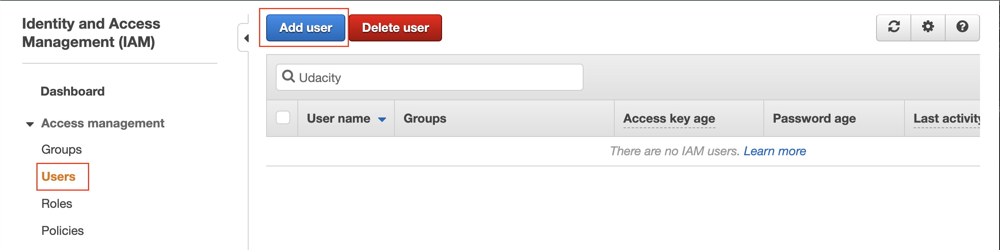

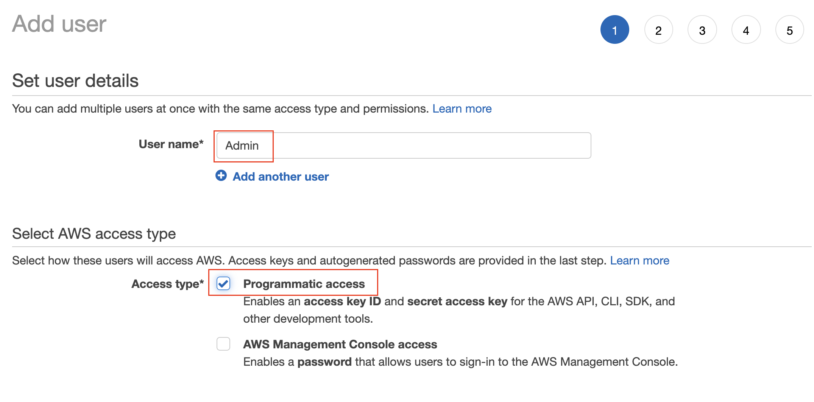

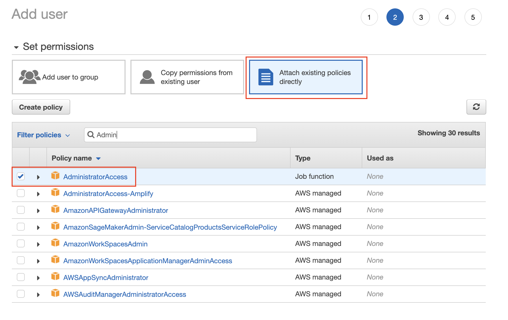

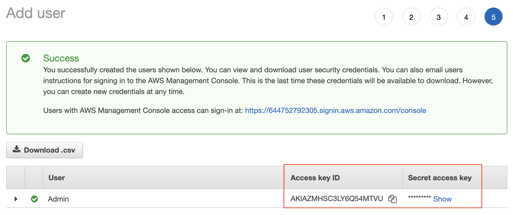

Log in using AWS SSO:

```text
https://<your-portal>.awsapps.com/start
Account > AdministratorAccess > Open AWS Console
```

```text
AWS Console: IAM > Users > Create user
  User name: deployment-admin
  Console access: leave disabled for this CLI-only exercise
  Permissions: Attach policies directly > AdministratorAccess (course demonstration)
    A group with the required policies is another way to manage permissions
  Tags: optional
  Review > Create user

Users > deployment-admin > Security credentials > Access keys > Create access key
  Use case: Command Line Interface (CLI)
  Review the alternatives and acknowledge the recommendation if prompted
  Description tag: optional
  Create access key
  Copy access key ID and secret access key, or download the CSV
    Store securely; the secret cannot be retrieved again after leaving this page

Older screenshots select "Programmatic access" during user creation
  In the current console, create the user first, then create its access key separately
```

#### Configure AWS CLI

- Use **AWS CLI v2** for both the SSO and IAM-key examples. Its installer includes Python; a separate Python installation is not required for CLI v2. The environment's PyPI `awscli` package is **CLI v1**, not an installation or upgrade of v2.
- A **profile** is a named set of local settings, not an AWS user. Keep credentials separate:
  - `deployment-course`: existing SSO profile; authenticate with `aws sso login`.
  - `deployment-course-iam`: new IAM user's access keys; configure with `aws configure`.
  - `deployment-course-classroom`: optional temporary (Udacity-provided) classroom credentials, including the session token.
- Configure the access key ID, secret access key (as shown below), default region, and output format. CLI v2 supports `json`, `yaml`, `yaml-stream`, `text`, and `table`.
  - The video uses `us-east-2`; this guide uses `eu-central-1`. Choose the region containing your resources.

```powershell
# Verify CLI v2; activation of .venv may put the PyPI CLI v1 first on PATH
# $env:PATH = "C:\Program Files\Amazon\AWSCLIV2;" + $env:PATH
aws --version
# Expected prefix: aws-cli/2

# One-time IAM profile setup; creates/updates this local profile only
aws configure --profile deployment-course-iam
# AWS Access Key ID: paste the new IAM user's access key ID: AWS_ACCESS_KEY_ID
# AWS Secret Access Key: paste its secret access key: AWS_SECRET_ACCESS_KEY
# Default region name: eu-central-1
# Default output format: json

# Long-term IAM keys do NOT use a session token
# A fresh IAM profile needs no token. If reusing an old profile, remove its
# aws_session_token line from ~/.aws/credentials; do not set it to the string "null"

# Optional alternative: configure classroom credentials in their own profile
# aws configure --profile deployment-course-classroom
# aws configure set aws_session_token (Read-Host "Classroom session token") --profile deployment-course-classroom
# Refresh the access key ID, secret, AND token together when they expire

# Inspect profile names and masked configuration; update an individual setting
aws configure list-profiles
# deployment-course
# deployment-course-iam
# ...
aws configure list --profile deployment-course-iam
aws configure set region eu-central-1 --profile deployment-course-iam

# Verify the actual identity before managing resources
aws sts get-caller-identity --profile deployment-course-iam
# IAM ARN: arn:aws:iam::<account-id>:user/deployment-admin

# First IAM exercise: list users (requires iam:ListUsers)
aws iam list-users --profile deployment-course-iam
# Output contains Users with Path, UserName, UserId, Arn, and CreateDate

# Explicit profile selection also works for Boto3
uv run python -c "import boto3; print(boto3.Session(profile_name='deployment-course-iam').client('sts').get_caller_identity()['Arn'])"

# Clear credentials inherited from other tools in THIS terminal before switching
# This does not delete credentials stored in ~/.aws/credentials
Remove-Item Env:AWS_ACCESS_KEY_ID, Env:AWS_SECRET_ACCESS_KEY, Env:AWS_SESSION_TOKEN, Env:AWS_SECURITY_TOKEN -ErrorAction SilentlyContinue

# Select IAM credentials for commands without --profile, if needed
$env:AWS_PROFILE = "deployment-course-iam"
aws sts get-caller-identity

# Return to the existing SSO profile for everyday work
$env:PATH = "C:\Program Files\Amazon\AWSCLIV2;" + $env:PATH
aws sso login --profile deployment-course
$env:AWS_PROFILE = "deployment-course"
aws sts get-caller-identity
# SSO ARN: arn:aws:sts::<account-id>:assumed-role/AWSReservedSSO_AdministratorAccess_.../<session-name>
uv run python -c "import boto3; print(boto3.Session(profile_name='deployment-course').client('sts').get_caller_identity()['Arn'])"
```

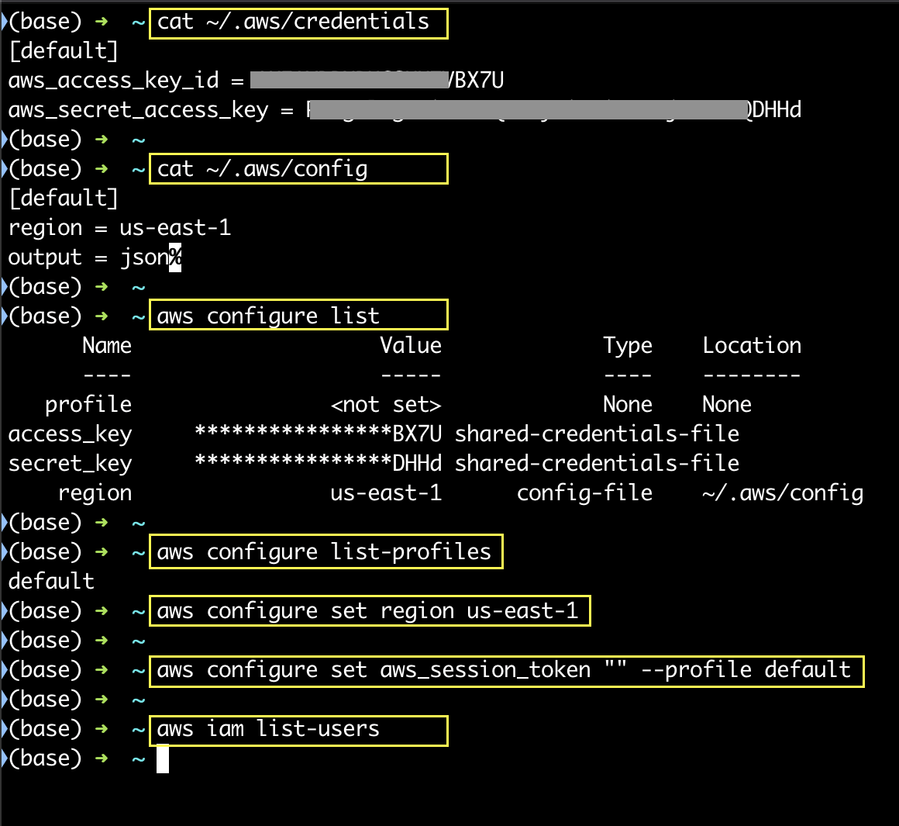

Additional notes:

- Standard files are discovered automatically:
  - `~/.aws/credentials` for access keys
  - and `~/.aws/config` for profile settings.
  - SSO settings and cached tokens remain separate from the IAM key profile.
  - `AWS_CONFIG_FILE` and `AWS_SHARED_CREDENTIALS_FILE` are only needed to override these paths. Git Bash does not require `setx` or permanently exported access keys.
- Avoid reusing the SSO profile name for `aws configure`: mixing static keys into it can cause the wrong identity to be selected. Keep SSO as your everyday profile.
- **Profile precedence:** explicit CLI `--profile` selects the named profile over `AWS_PROFILE` and environment access keys. In Boto3, use `Session(profile_name=...)` to explicitly select profile credentials.
  - When relying only on `AWS_PROFILE`, environment access keys can take precedence; clear stale variables as above. Without an explicit profile or `AWS_PROFILE`, the default profile is used if no higher-priority credentials are present.
  - Bash equivalents: `export AWS_PROFILE=deployment-course` and `unset AWS_ACCESS_KEY_ID AWS_SECRET_ACCESS_KEY AWS_SESSION_TOKEN AWS_SECURITY_TOKEN`.
  - A browser SSO session does not automatically select a CLI profile. `.env` is loaded only if your Python application calls `load_dotenv()`; loading stale keys there can change Boto3's credential selection.
- See [named profile configuration](https://docs.aws.amazon.com/cli/latest/userguide/cli-configure-profiles.html) and [Boto3 credential selection](https://docs.aws.amazon.com/boto3/latest/guide/credentials.html).

#### S3 Management via AWS CLI

- Use `aws s3` for convenient transfers/listing and `aws s3api` for individual S3 API (application programming interface) operations.
- General-purpose bucket names must be unique across accounts and regions within an AWS partition. Replace the example suffix; choose the region containing your application.
- New buckets are private, with Block Public Access enabled and ACLs (access control lists) disabled by default.
  - The original course's `--acl bucket-owner-full-control` does **not** make a bucket public and is unnecessary with current ownership defaults; omit it.
  - Prefer a temporary presigned URL for sharing. Public access requires a policy and compatible Block Public Access settings, not just an object URL.
  - Otherwise, we can make an object public via the web UI too: select the object, choose "Object actions" > "Make public".
- Supporting material: [`assets/sample.html`](./assets/sample.html). Save it locally if needed; the examples run from `01_ServerDeployment/`.

```powershell
# Replace this name with a unique lowercase name; use it consistently below
$bucket = "mybucket-xyz-123-abc"
$region = "eu-central-1"

# Create a PRIVATE bucket; outside us-east-1, LocationConstraint must match the region
aws s3api create-bucket --bucket $bucket --region $region --create-bucket-configuration "LocationConstraint=$region" --profile deployment-course-iam
# For us-east-1 instead, omit --create-bucket-configuration entirely

# Upload: --key is the destination object name; --body is the local file path
# --content-type sets the MIME (Multipurpose Internet Mail Extensions) media type
aws s3api put-object --bucket $bucket --key sample.html --body assets/sample.html --content-type text/html --profile deployment-course-iam

# Verify in S3's web console, or list buckets and objects from the terminal
aws s3 ls --profile deployment-course-iam
aws s3 ls "s3://$bucket/" --recursive --profile deployment-course-iam

# Download to a new local file
aws s3 cp "s3://$bucket/sample.html" ./assets/sample-downloaded.html --profile deployment-course-iam

# Share a private object temporarily: open the printed URL in your browser
# URL lifetime is at most 1 hour here, and cannot exceed the signing credentials' lifetime
# Another option is in the web UI: select object - Object actions > Make public using ACL
aws s3 presign "s3://$bucket/sample.html" --expires-in 3600 --region $region --profile deployment-course-iam
# The generated URL will allow temporary access to the private object.
```

Clean up after the exercise:

```powershell
# A bucket must be empty before deletion; delete the uploaded object first
aws s3api delete-object --bucket $bucket --key sample.html --profile deployment-course-iam
aws s3api delete-bucket --bucket $bucket --region $region --profile deployment-course-iam

# Confirm deletion in the S3 dashboard or list the remaining buckets
aws s3 ls --profile deployment-course-iam
# If versioning was enabled separately, also delete all versions and delete markers
# before deleting the bucket; these examples assume a new unversioned lab bucket
```

References:

- [create-bucket](https://docs.aws.amazon.com/cli/latest/reference/s3api/create-bucket.html)
- [put-object](https://docs.aws.amazon.com/cli/latest/reference/s3api/put-object.html)
- [S3 API commands](https://docs.aws.amazon.com/cli/latest/reference/s3api/index.html#available-commands).

#### Extra: IAM Management via AWS CLI

```powershell
# List IAM users and customer-managed policies
aws iam list-users --profile deployment-course-iam
aws iam list-policies --scope Local --profile deployment-course-iam

# Create an example user and grant read-only S3 access
aws iam create-user --user-name example-user --profile deployment-course-iam
aws iam attach-user-policy --user-name example-user --policy-arn arn:aws:iam::aws:policy/AmazonS3ReadOnlyAccess --profile deployment-course-iam

# Remove the policy, then delete the example user (no keys/password were created)
aws iam detach-user-policy --user-name example-user --policy-arn arn:aws:iam::aws:policy/AmazonS3ReadOnlyAccess --profile deployment-course-iam
aws iam delete-user --user-name example-user --profile deployment-course-iam
```

#### Extra: EC2 Management via AWS CLI

```powershell
# List instances and security groups in Frankfurt
aws ec2 describe-instances --region eu-central-1 --profile deployment-course-iam
aws ec2 describe-security-groups --region eu-central-1 --profile deployment-course-iam

# Launch one instance; replace dummy IDs with a compatible AMI, subnet, and security group
aws ec2 run-instances --image-id ami-xxx --instance-type t3.micro --count 1 --key-name example-key --subnet-id subnet-xxx --security-group-ids sg-xxx --region eu-central-1 --profile deployment-course-iam

# Stop, then start an instance; wait for each transition to finish before the next action
aws ec2 stop-instances --instance-ids i-xxx --region eu-central-1 --profile deployment-course-iam
aws ec2 start-instances --instance-ids i-xxx --region eu-central-1 --profile deployment-course-iam

# Permanently terminate the example instance
aws ec2 terminate-instances --instance-ids i-xxx --region eu-central-1 --profile deployment-course-iam
```

#### Extra: RDS Management via AWS CLI

```powershell
# List database instances and snapshots
aws rds describe-db-instances --region eu-central-1 --profile deployment-course-iam
aws rds describe-db-snapshots --region eu-central-1 --profile deployment-course-iam

# Create private PostgreSQL; replace the subnet group and security group with existing ones
# AWS Secrets Manager generates/stores the master password (additional charges apply)
aws rds create-db-instance --db-instance-identifier example-db --engine postgres --db-instance-class db.t4g.micro --allocated-storage 20 --storage-type gp3 --db-name courseapp --master-username postgres --manage-master-user-password --db-subnet-group-name example-db-subnets --vpc-security-group-ids sg-xxx --no-publicly-accessible --no-multi-az --region eu-central-1 --profile deployment-course-iam

# Wait until available, then retrieve its endpoint
aws rds wait db-instance-available --db-instance-identifier example-db --region eu-central-1 --profile deployment-course-iam
aws rds describe-db-instances --db-instance-identifier example-db --query "DBInstances[0].Endpoint.Address" --output text --region eu-central-1 --profile deployment-course-iam

# Connect from EC2 in the VPC; use the password from Secrets Manager when prompted
psql "host=example-db.abcdefghijkl.eu-central-1.rds.amazonaws.com port=5432 dbname=courseapp user=postgres sslmode=require" -W

# Permanently delete the disposable database without a final snapshot or retained backups
aws rds delete-db-instance --db-instance-identifier example-db --skip-final-snapshot --delete-automated-backups --region eu-central-1 --profile deployment-course-iam
```

### Introduction to Kubernetes

- Containers package applications, but running them individually on one machine makes scaling, updates, and capacity management difficult.
- **Vertical scaling** gives a machine or workload more CPU and memory. It can be difficult to adjust automatically, and large machines may cost more or sit underused.
- **Horizontal scaling** runs more application instances across machines. Container images make it practical to add or remove copies as demand changes.
- **Kubernetes** is an open-source container orchestration platform, originating at Google and open-sourced in 2014. It automates deploying, scaling, and managing containerized applications.
  - Manages multiple containers across machines and helps match running workloads to their desired state.
  - Supports horizontal scaling, load balancing, service discovery, networking, and health checks.
  - Provides high availability, automated updates, container health management, and configuration and secret management.
  - Cloud resources can provide additional capacity when local or on-premises servers are insufficient; Kubernetes itself does not make infrastructure unlimited.
  - Its broad feature set and ecosystem bring operational complexity and a learning curve.
- Further reading: [Scaling containerized apps at Google](https://queue.acm.org/detail.cfm?id=2898444) and the [Kubernetes overview](https://kubernetes.io/docs/concepts/overview/).

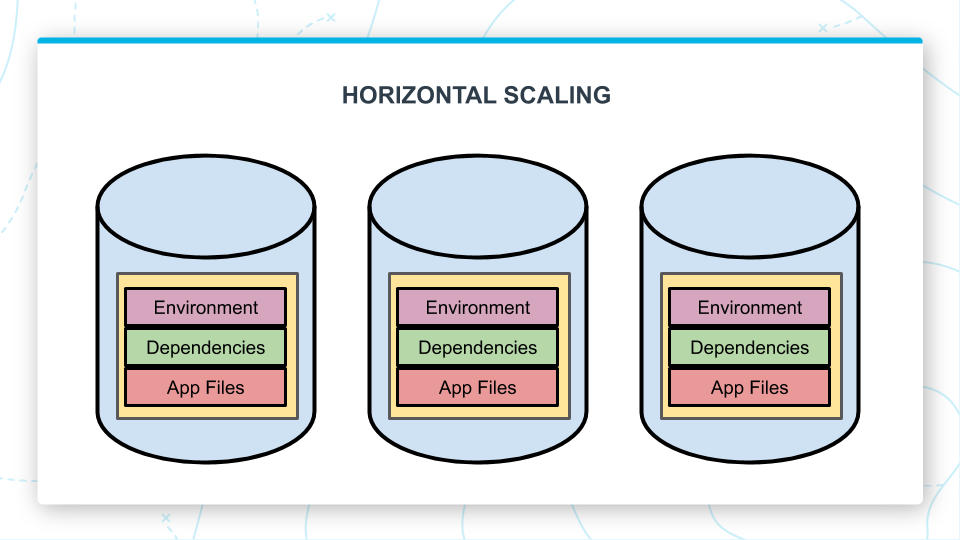

### Kubernetes Concepts

- A **Kubernetes cluster** is a set of machines managed together. Its **control plane** coordinates the cluster; older material often calls this the *master*.
- **Nodes** are the virtual or physical worker machines where workloads run. The control plane schedules Pods on nodes based on available resources; a node can run multiple Pods and needs a supported container runtime.
- A **Pod** is Kubernetes’ smallest deployable unit and contains one or more closely related containers.
  - Containers in a Pod share its network namespace and can share mounted volumes.
  - Each Pod has its own cluster IP, but Pods are ephemeral: they can be replaced, moved, or removed during scaling and recovery.
- A **Service** selects a set of Pods and provides a stable way to reach them as individual Pod IPs change. It can distribute traffic across matching Pods.
- A **Volume** provides storage mounted into one or more containers in a Pod. Pod-local ephemeral storage does not survive Pod replacement; use persistent storage when data must outlive a Pod.
- Replicating application Pods across nodes can reduce dependence on a single node and improve availability, provided the cluster and application are configured for it.
- Common workflow: create a cluster, deploy an application, expose its ports through a Service, then scale or update the application.
- Cluster options:
  - Run a local cluster for development. Docker Desktop is one option when Kubernetes is enabled.
  - Use a cloud provider's managed service. This course uses **Amazon EKS (Elastic Kubernetes Service)**; other examples include Google Kubernetes Engine (GKE) and Azure Kubernetes Service (AKS).
- For hands-on learning, see:
  - the [Kubernetes cluster introduction](https://kubernetes.io/docs/tutorials/kubernetes-basics/create-cluster/cluster-intro/)
  - and the [interactive cluster tutorial](https://kubernetes.io/docs/tutorials/kubernetes-basics/create-cluster/cluster-interactive/).

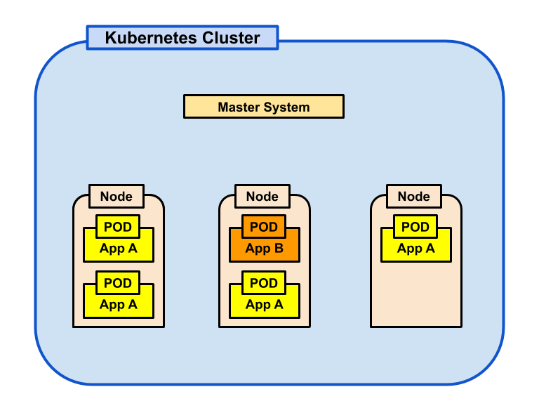

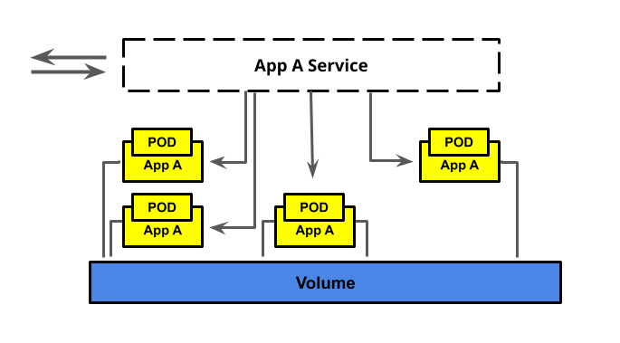

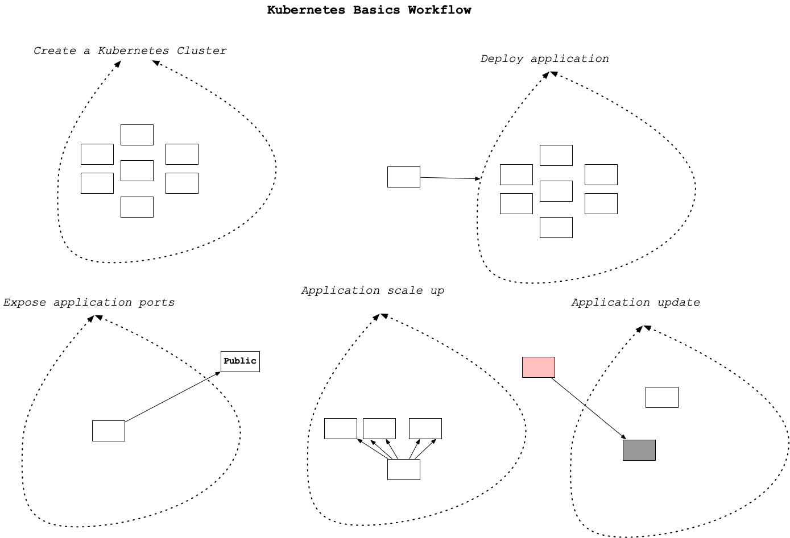

More information:

- [Kubernetes cluster components overview](https://kubernetes.io/docs/concepts/overview/components/)
- [Pods documentation](https://kubernetes.io/docs/concepts/workloads/pods/)

### Kubernetes Components

- A cluster contains the **control plane**, which manages the cluster, and **worker nodes**, which run application Pods. In managed services such as EKS, the provider manages the control plane.
- **Control plane components:**
  - `kube-apiserver` exposes the Kubernetes API. Users, cluster components, and tools communicate with the cluster through it; it serves requests to read or change objects such as Pods, Namespaces, ConfigMaps, and Events.
  - `etcd` stores the cluster's state and data as a consistent, highly available key-value store.
  - `kube-scheduler` watches for Pods that have no assigned node and selects a node for each.
  - `kube-controller-manager` runs controllers that observe cluster state and work to move it toward the desired state.
  - `cloud-controller-manager` integrates Kubernetes with a cloud provider's APIs; it is used when the cluster needs cloud-specific control logic.
- **Node components:**
  - `kubelet` runs on each node and ensures assigned Pods and their containers are running as specified.
  - A **container runtime** runs the containers. Kubernetes uses a compatible runtime such as containerd or CRI-O; Docker Engine is no longer directly integrated through Kubernetes' removed dockershim.
  - `kube-proxy`, when used by the cluster, maintains node network rules that support communication to Services and their Pods.

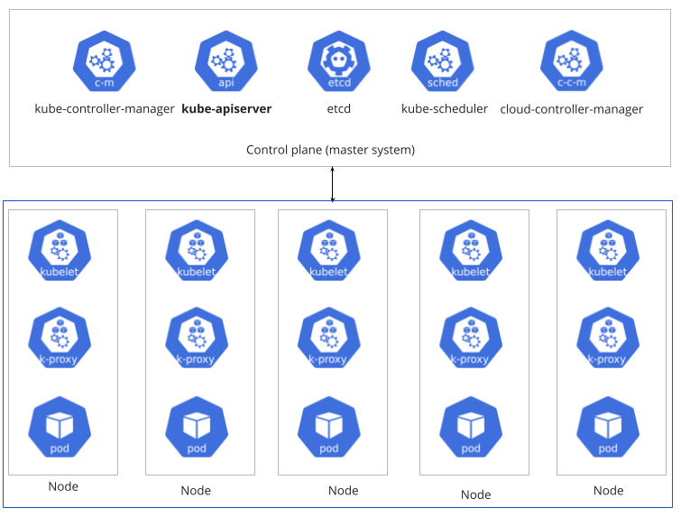

References: [Kubernetes components](https://kubernetes.io/docs/concepts/overview/components/) and the [Kubernetes API](https://kubernetes.io/docs/concepts/overview/kubernetes-api/).

### EKS: Amazon Elastic Kubernetes Service

- **Amazon EKS** is AWS's managed Kubernetes service. AWS operates the Kubernetes control plane, including its availability across multiple Availability Zones (AZs) and control plane maintenance.
- The cluster's **data plane** runs application Pods on compute nodes. You choose and manage the compute approach, such as managed node groups or Fargate; autoscaling requires configuring the appropriate cluster and workload scaling.
- EKS connects the Kubernetes cluster with AWS networking and services. You still configure worker capacity, application deployments, Services, permissions, and access to AWS resources.
- Managed control plane availability does not automatically make application workloads highly available. Run enough replicas across AZs and configure storage, networking, backups, and recovery for your needs.
- AWS manages control plane backups and recovery mechanisms, but you remain responsible for protecting application data and planning workload recovery.
- Further reading: [What is Amazon EKS?](https://docs.aws.amazon.com/eks/latest/userguide/what-is-eks.html).

### Creating an EKS Cluster via Web UI Console

- This walkthrough creates an Amazon EKS cluster and a managed node group with two worker nodes.
- An EKS cluster has two main parts:
  - The **control plane** is the Kubernetes management layer. It includes the API server and etcd, the database that stores cluster state, and AWS runs it in AWS-managed accounts.
  - The **data plane** consists of worker nodes (physical and/or virtual machines) that run application containers in Kubernetes Pods. In this exercise, the workers are EC2 instances in your AWS account.
- The control plane schedules Pods and manages worker nodes.
  - A Pod is Kubernetes’ smallest deployable unit and can contain one or more related containers.
  - Each worker node runs a kubelet agent, which keeps the node and its Pods in the expected state.
  - Each worker node also runs kube-proxy, which helps implement network communication for Kubernetes Services.
  - A container runtime runs containers. Current Kubernetes nodes use a CRI-compatible runtime such as containerd; Docker Engine is no longer directly integrated through Kubernetes’ removed dockershim = *each worker node needs software to run containers, and Kubernetes communicates with that software through a standard interface. Modern Kubernetes setups commonly use containerd.*
    - A container runtime is the software on a worker node that starts and stops containers. Kubernetes decides what should run; the runtime does the hands-on work of running it.
    - Kubernetes manages the cluster and tells a node, “Run this container.”
    - The kubelet, an agent on each worker node, passes that request to the runtime.
    - containerd is a runtime: it downloads container images and runs the containers.
    - CRI means Container Runtime Interface. It’s the standard connection Kubernetes uses to communicate with runtimes.
    - Docker Engine is a broader toolset for building and running containers. Older Kubernetes versions could connect to Docker Engine through a compatibility layer called dockershim. Kubernetes removed that layer, so Kubernetes now typically talks to containerd directly. Docker-built images can still run on Kubernetes; the change concerns the software that runs them on the node.
- Creating a cluster and deploying an application are separate tasks. This section creates the cluster, and a later course section deploys a sample Flask application.
- EKS can be created through the AWS web console or AWS CLI. This walkthrough uses the console, and later sections use the CLI.
- The prerequisites are a VPC (Virtual Private Cloud = an isolated virtual network in AWS) and subnets, an IAM role for the EKS control plane, and an IAM role for the worker nodes.
  - An SSH key pair is optional and can provide access to an EC2 node for troubleshooting or inspecting logs.
  - A **VPC** is an isolated virtual network in AWS.
  - A **subnet** is an address range within one Availability Zone (AZ), which is a separate physical location within an AWS Region.
  - EKS requires cluster subnets in at least two AZs.

#### Part 1: Prerequisites

Log in using AWS SSO:

```text
https://<your-portal>.awsapps.com/start
Account > AdministratorAccess > Open AWS Console
```

**Overview**

1. Check that the VPC has at least two suitable subnets in the Region where you plan to create the EKS cluster. If not, create them.
2. Create one IAM role for the EKS control plane and another for the EC2 worker nodes.
3. Optionally create an EC2 key pair in that same Region if you plan to connect to the worker nodes over SSH.

**1. Default VPC and subnets**

- In the VPC console, check whether a default VPC is already set up.
- Confirm that the VPC you plan to use has at least two subnets in the desired AWS Region, such as **eu-central-1**.
- Check the **Availability Zone** column and confirm the subnets are in different AZs, such as **eu-central-1a** and **eu-central-1b**.
- If there is no default VPC, follow [AWS's instructions for creating a default VPC](https://docs.aws.amazon.com/vpc/latest/userguide/default-vpc.html#create-default-vpc).
- A default VPC typically has a **/16** IPv4 CIDR block, which provides up to 65,536 addresses.
  - A CIDR (Classless Inter-Domain Routing) block describes a range of IP addresses, and the smaller the number after the slash, the larger the range.
  - In `10.0.0.0/16`, the `/16` means the first 16 bits are reserved for the network; the remaining 16 bits (32-16) identify addresses within it.
  - That leaves 2¹⁶ = 65,536 possible addresses within the network.
  - The VPC’s **/16** is the overall address range for the network, encompassing all possible IP addresses within it.
- A default VPC can also have **/20** subnets in each AZ, route tables, and an internet gateway.
  - A **/20** subnet has 2¹² = 4,096 possible addresses within it.

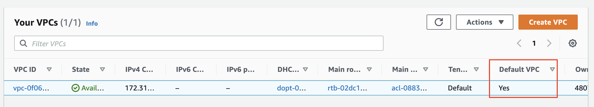

**2a. Cluster IAM role: myEKSClusterRole**

- An IAM role is a set of permissions assumed by a trusted service or resource. Its *trust policy* defines who can assume it, and its *permission policies* define what actions it allows.
- In **IAM -> Roles**, create the role that the EKS control plane will assume to manage AWS resources for the cluster: IAM > Roles > Create role.
- Choose **AWS service** as the trusted entity, search for EKS (use case), and select **EKS - Cluster**.
- The `AmazonEKSClusterPolicy` should be selected automatically.
- Name the role **myEKSClusterRole** or another meaningful name, then create it.

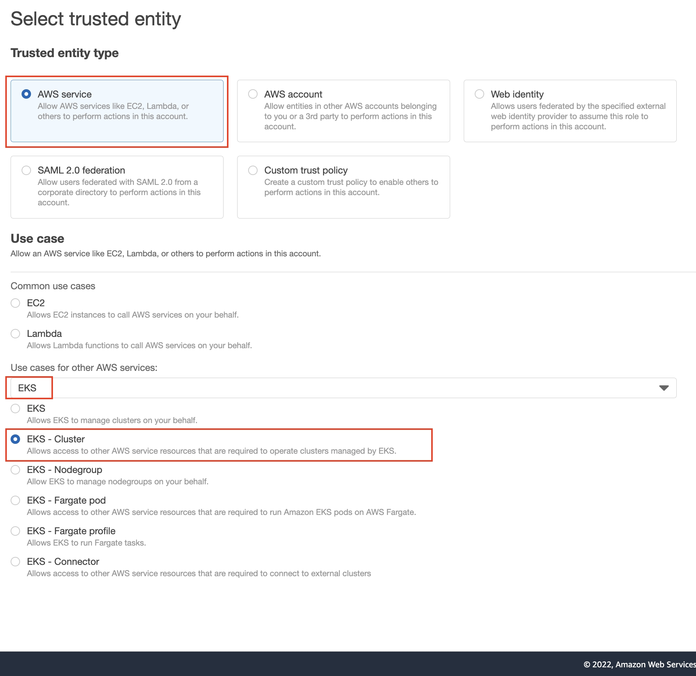

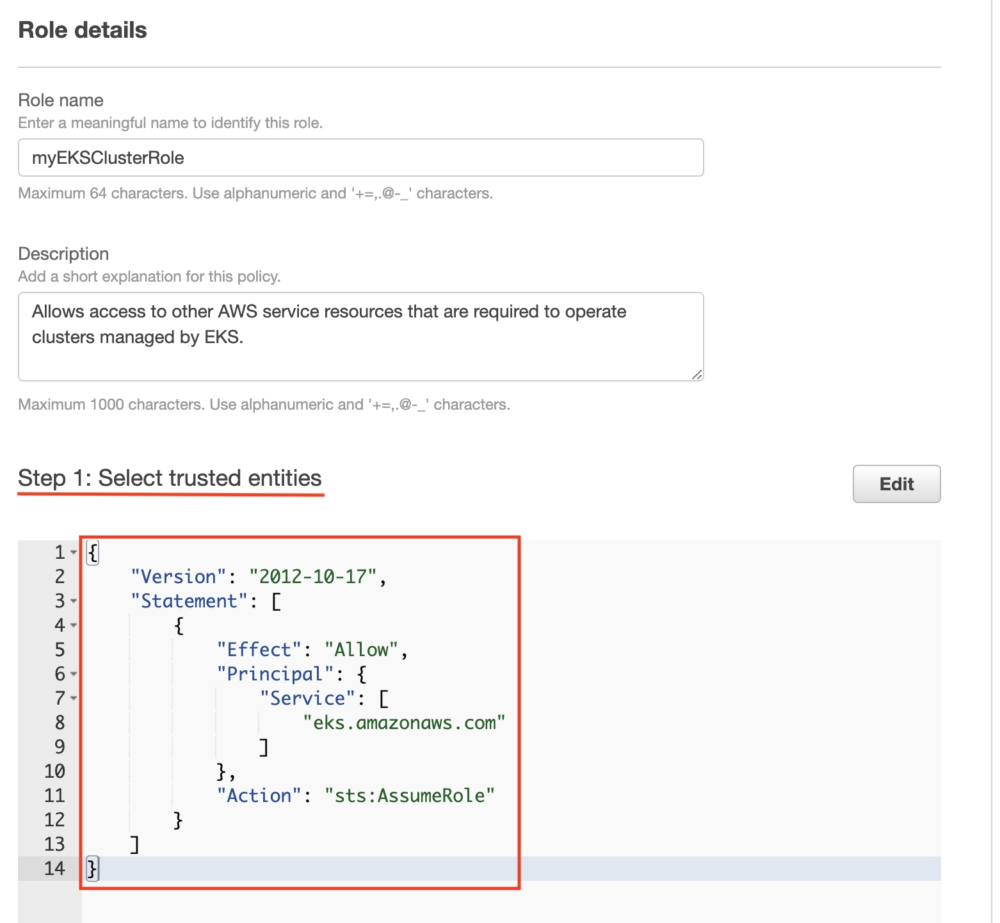

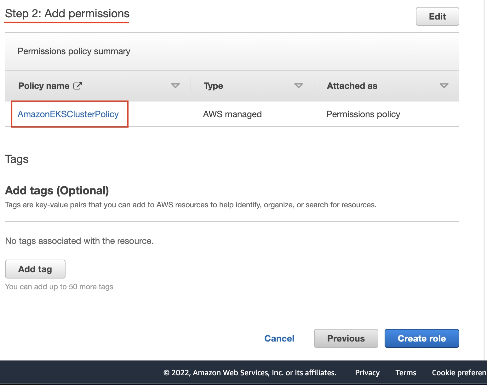

**2b. Worker-node IAM role: myEKSWorkerNodeRole**

- The [kubelet](https://kubernetes.io/docs/reference/command-line-tools-reference/kubelet/#synopsis) running on each worker node uses this role to call AWS APIs.
- Create another role, such as **myEKSWorkerNodeRole**, with **EC2** as the trusted entity and use case: IAM > Roles > Create role.
  - Trusted entity type: AWS service.
  - Use case: EC2 - Allows EC2 instances to assume this role.
- The recording notes that some permissions may be attached automatically by the EC2 use case; review the list and add the required worker-node permissions below.
- Attach these policies for the configuration shown in the recording:
  - **AmazonEKSWorkerNodePolicy**
  - **AmazonEC2ContainerRegistryReadOnly** (AWS now recommends **AmazonEC2ContainerRegistryPullOnly**, which has a narrower scope.)
  - **AmazonEKS_CNI_Policy**
- AWS now recommends using **AmazonEC2ContainerRegistryPullOnly** for image pulls and assigning VPC CNI permissions to the **aws-node** add-on's service account role where possible.
- The three policies above are retained to match this course walkthrough, but review current AWS guidance for a new cluster.
- If needed, follow AWS's [worker-node role instructions](https://docs.aws.amazon.com/eks/latest/userguide/create-node-role.html#create-worker-node-role).

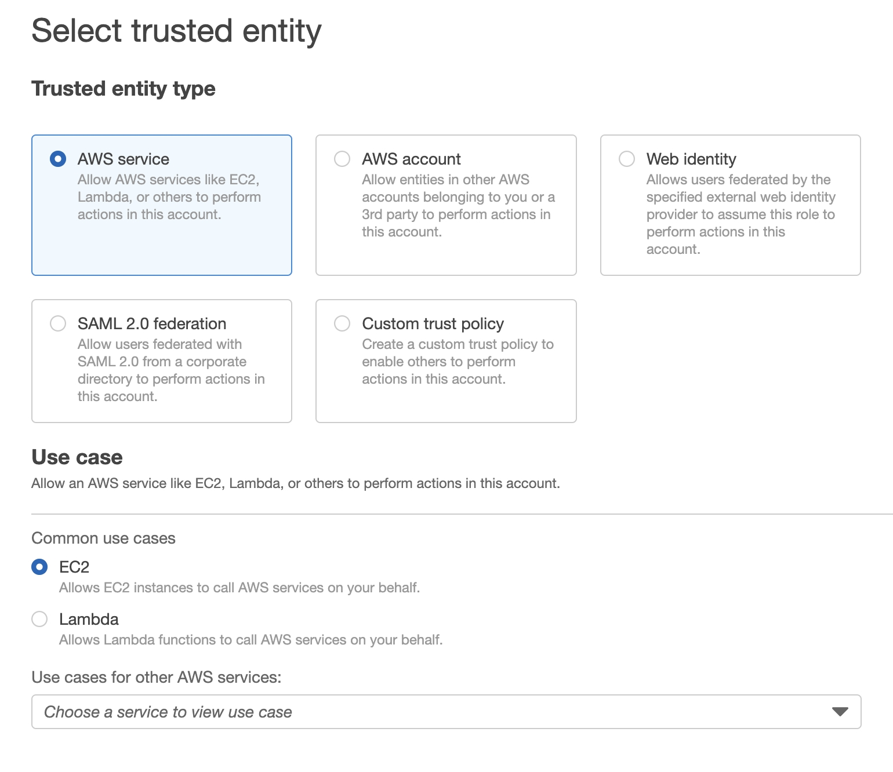

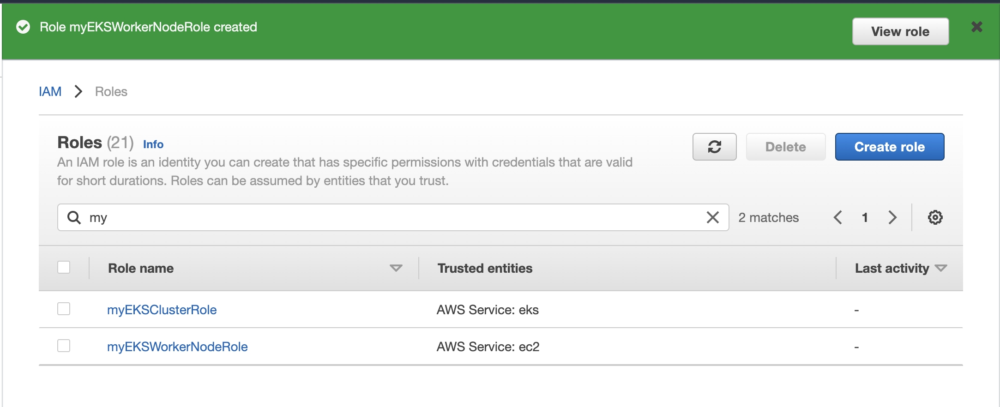

**3. Optional SSH key pair**

- Create the key pair in the same AWS Region where you will create the EC2 worker nodes. The recording starts in **us-east-1** and then switches to **us-east-2**, so verify the selected Region before creating the key.
- We create an AWS public/private key pair for logging in to an EC2 instance.
  - AWS places the public key on the instance; we will specify the key when creating the EKS worker nodes (EC2 instances).
  - We keep the private key (`*.pem`) and use it to authenticate instead of a password.
- In **EC2 -> Network & Security -> Key Pairs**, choose **Create key pair**.
- Enter a name (`eks-course-ec2-key`) and choose RSA for broad compatibility.
- Choose **.pem** for OpenSSH or **.ppk** if you connect with PuTTY.
- Leave the remaining fields at their defaults.
- AWS downloads the private key to your computer, so keep it private and secure; git-ignore it!

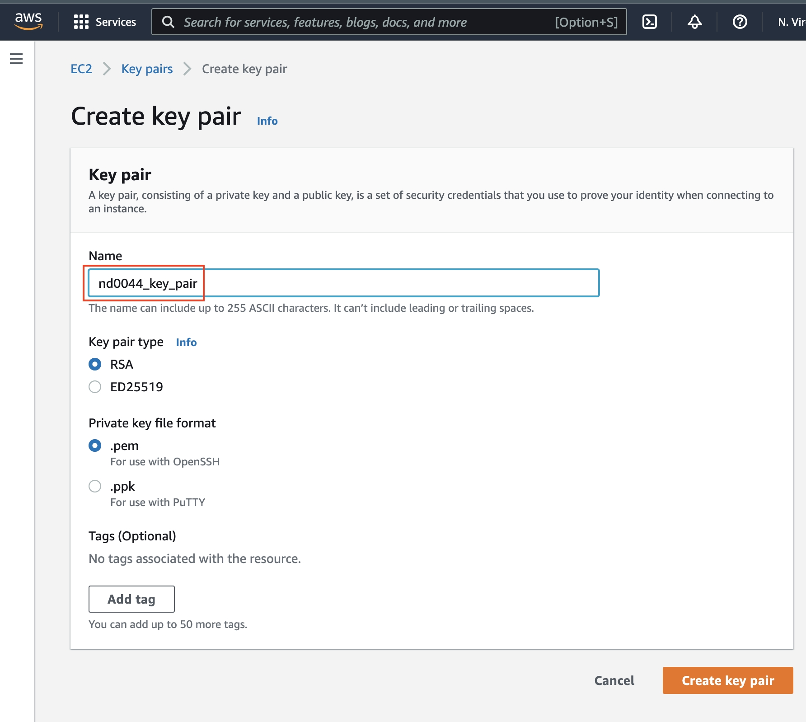

#### Part 2: Create the EKS Cluster

Log in using AWS SSO:

```text
https://<your-portal>.awsapps.com/start
Account > AdministratorAccess > Open AWS Console
```

Notes:

- The control plane runs in AWS-managed accounts, while worker nodes run in your account.
- Once the control plane is ready, attach worker nodes to run Pods.

**Cluster configuration**

- In **EKS -> Clusters**, choose **Add cluster** or **Create cluster**.
- Enter a name such as **myEKSCluster**, select a Kubernetes version offered in the console, and choose the cluster IAM role created above: `myEKSClusterRole`.
- The recording uses the default Kubernetes version and leaves the other settings unchanged.
- Kubernetes **1.37** is version I chose -- write it down for reference.
- Node IAM role: `myEKSWorkerNodeRole`.

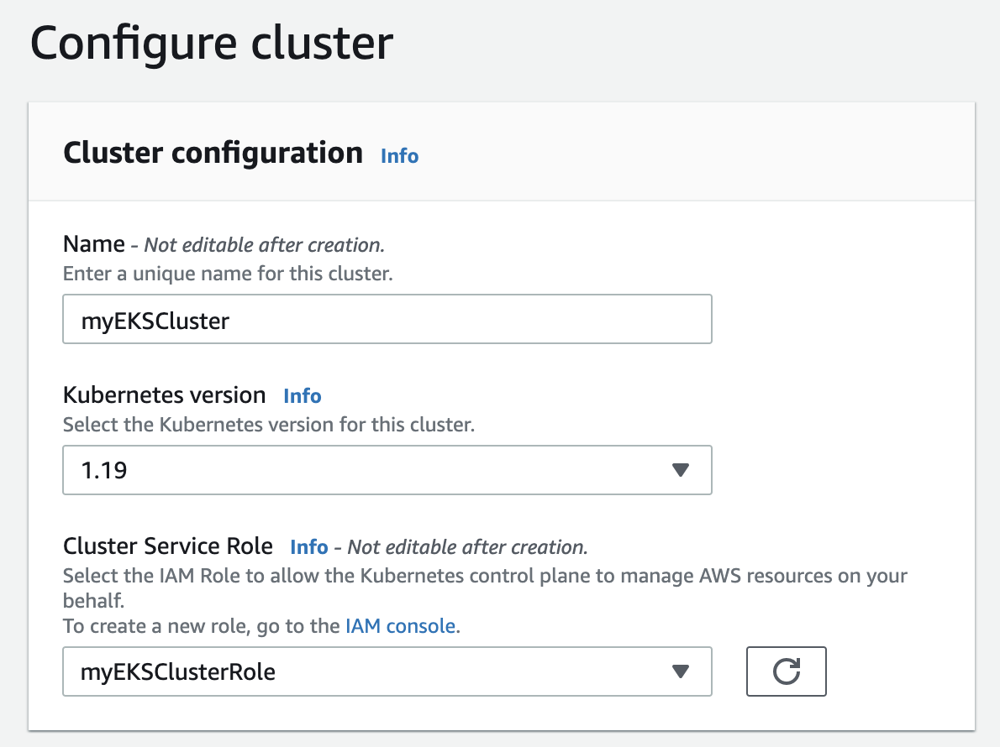

- Choose the VPC, subnets, and security group.
  - A security group is a virtual firewall that controls allowed inbound and outbound connections.
  - Make the cluster API endpoint publicly accessible as shown in the tutorial.
    - Cluster endpoint access: Public / [x] Public and Private
  - Public access to the API endpoint controls access to the Kubernetes management API; it does not by itself make your application or Pods public.
- EKS requires cluster subnets in at least two AZs.
  - Use subnets belonging to your selected Region and account.
  - If EKS reports insufficient capacity in an AZ, retry with at least two subnets in AZs that AWS reports as available.

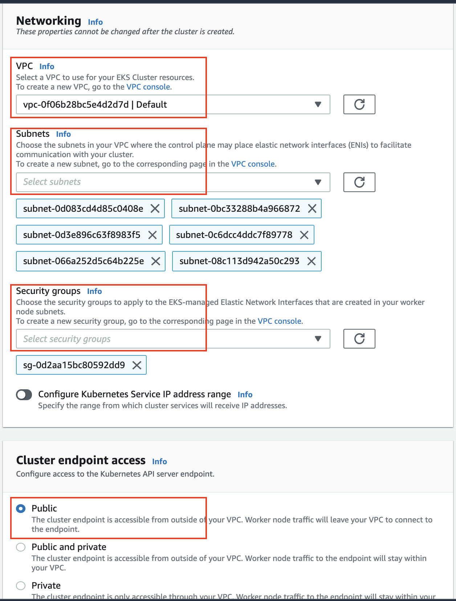

- Accept the default logging settings and create the cluster.
- Don't add any add-ons, unless you know what they do and need them for your cluster; they are not free!
- Wait several minutes for the cluster to become active.

#### Part 3: Create a Node Group

Log in using AWS SSO:

```text
https://<your-portal>.awsapps.com/start
Account > AdministratorAccess > Open AWS Console
```

Notes:

- A **node group** is a set of worker machines used to run Pods; when we create a cluster and launch it, it still doesn't have the nodes!
- This walkthrough creates a managed node group of two EC2 instances.
- However, it is recommended creating the cluster and node group using **eksctl** for simplicity and consistency, rather than manually through the console.
- For an overview of Kubernetes components, see the [Kubernetes components documentation](https://kubernetes.io/docs/concepts/overview/components/).


**Add a node group**

- When the cluster shows **Active**, select its name to view the details.

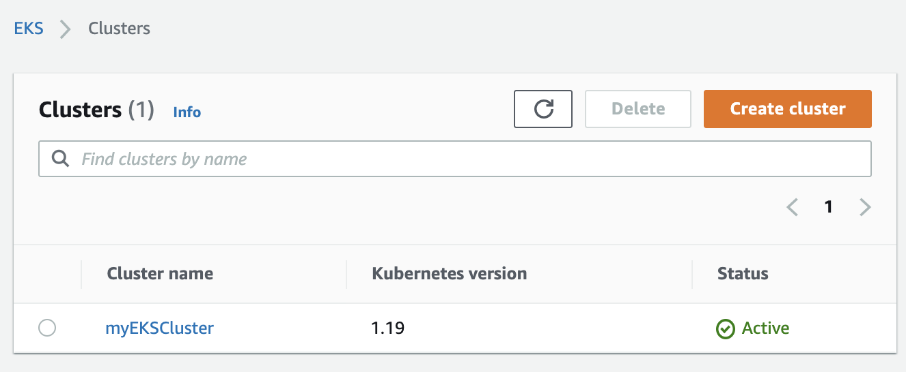

- In the current console, open the cluster's **Compute** tab (left panel)
  - Node groups: choose **Add** / **Add node group**.
- The screenshots below show the course recording's console layout, so the labels or navigation position may differ from what you see now.

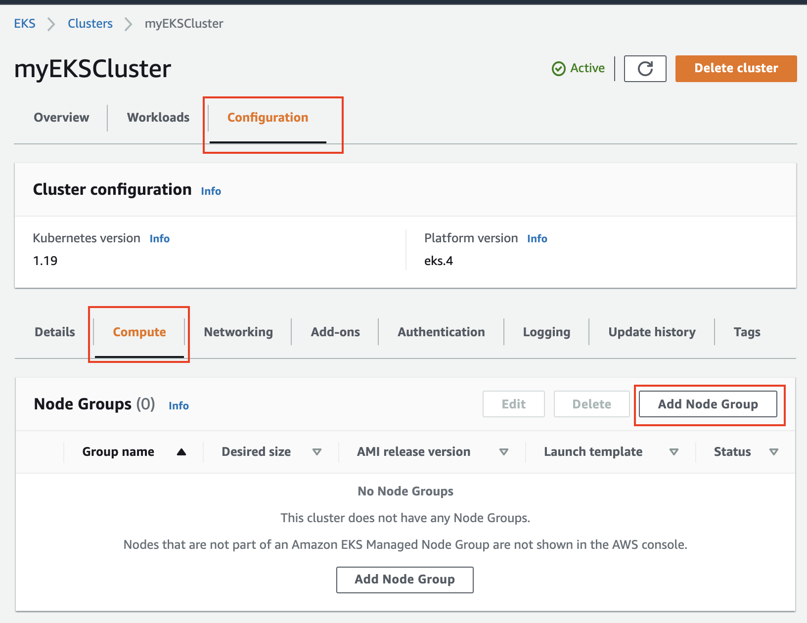

**Node-group configuration**

- Enter a node-group name (`myNodeGroup`) and attach the **myEKSWorkerNodeRole** IAM role.
  - This role gives the kubelet permission to make required AWS API calls.
- Leave the other fields in this section at their defaults.

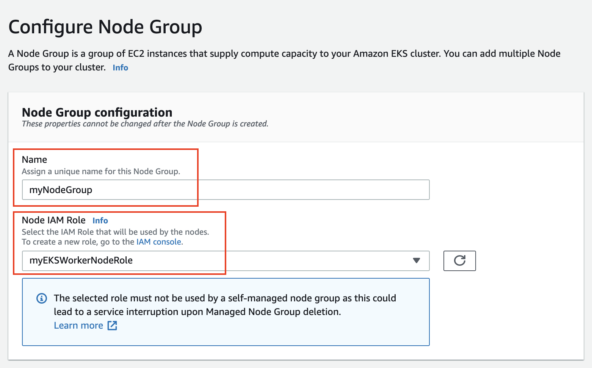

- Select the operating system (AMI), instance hardware, storage, and number of worker nodes.
- The following values are examples, not current recommendations:
  - The AMI type is Amazon Linux 2023 (x86_64)
  - The capacity type is **On-Demand**, which charges for EC2 capacity as it runs. See [EC2 instance purchasing options](https://docs.aws.amazon.com/AWSEC2/latest/UserGuide/instance-purchasing-options.html).
  - The instance type is **t3.micro**, listed in the recording as having 2 vCPUs and 1 GiB of memory. This is a very small example and may not have enough capacity for useful workloads.
  - The disk size is **20 GiB** for each worker node.
  - The minimum node-group size is **2**, which is the lower bound when scaling in.
  - The maximum node-group size is **2**, which is the upper bound when scaling out.
  - The desired size is **2**, which is the target node count.
- With minimum, maximum, and desired all set to 2, the group is configured for two nodes.
- Changing these values sets the allowed node range and target, while scaling workloads also requires suitable autoscaling configuration.

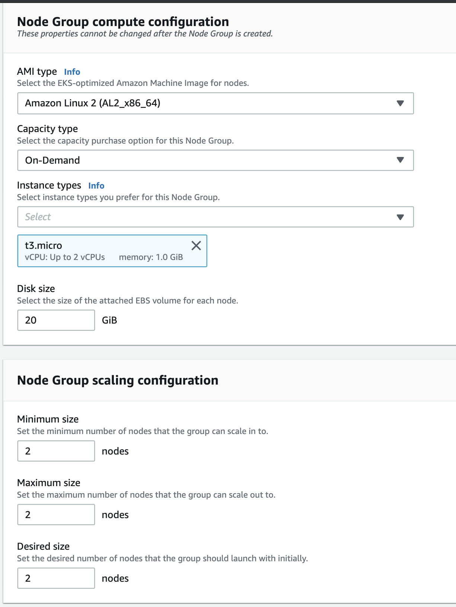

- Choose the subnets selected when creating the cluster.
- Allow remote instance access.
  - Configure remote acces to nodes: Activate
  - Select created SSH key pair: `eks-course-ec2-key`
  - We need to have the `PEM` we downloaded locally.
  - The original tutorial says to allow remote access from anywhere on the Internet.
    - Allo remote access from: All
- For a real cluster, restrict SSH to your own public IP address, usually a **/32** CIDR range, or leave remote SSH disabled if you do not need it.

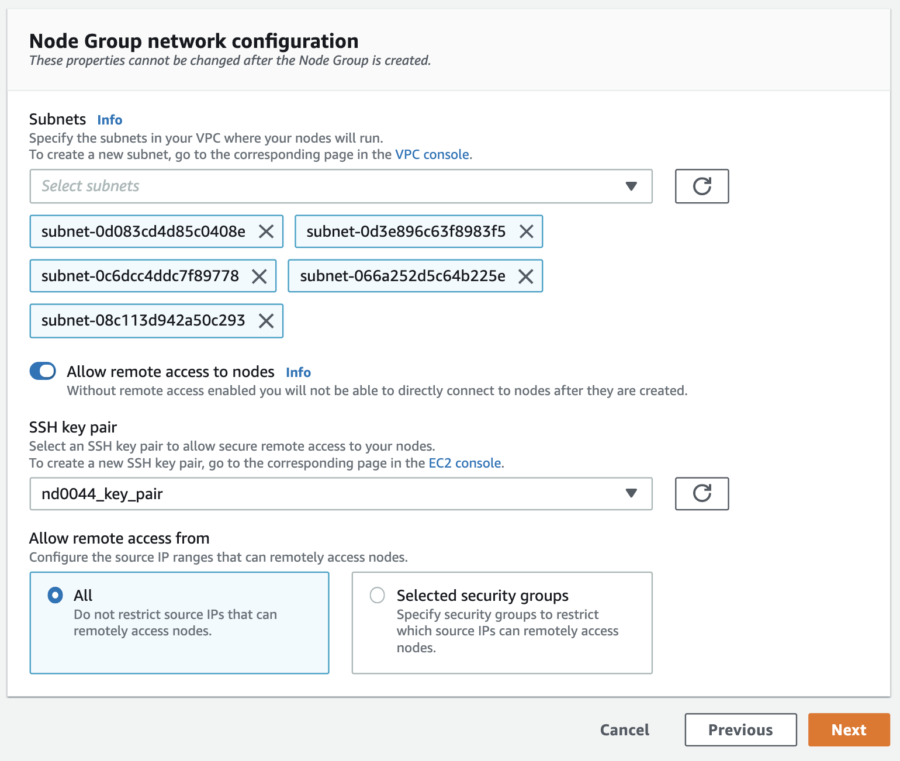

- Review the settings and finish creating the node group.

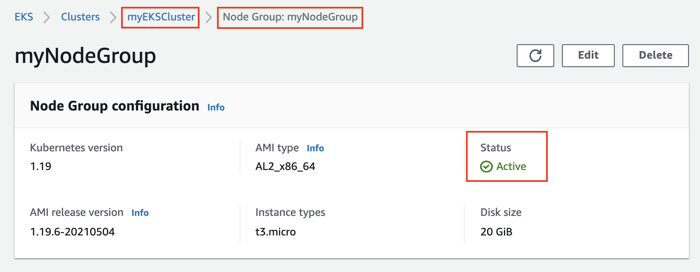

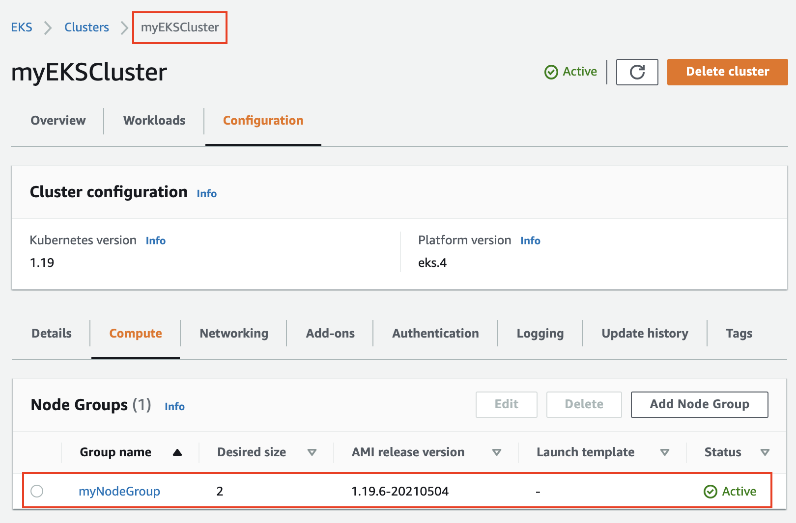

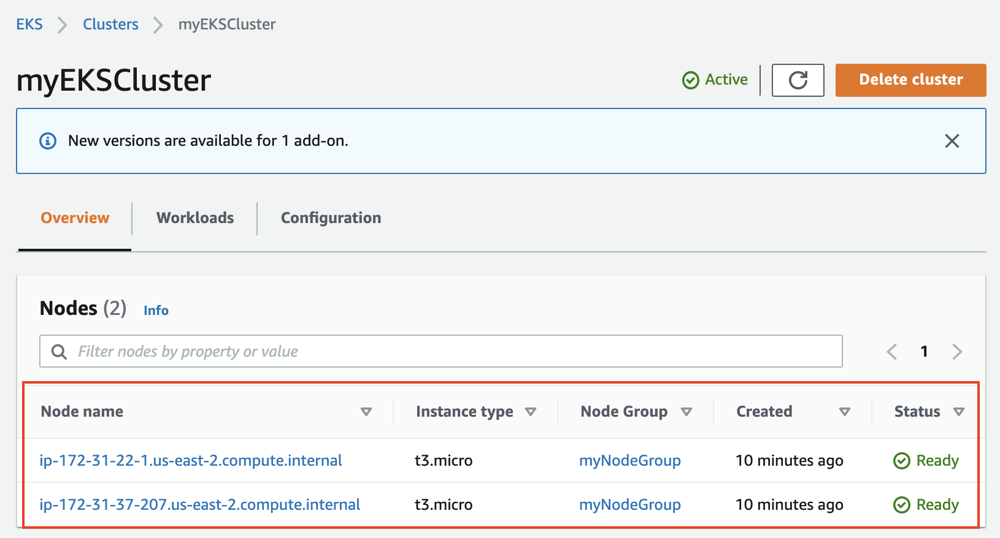

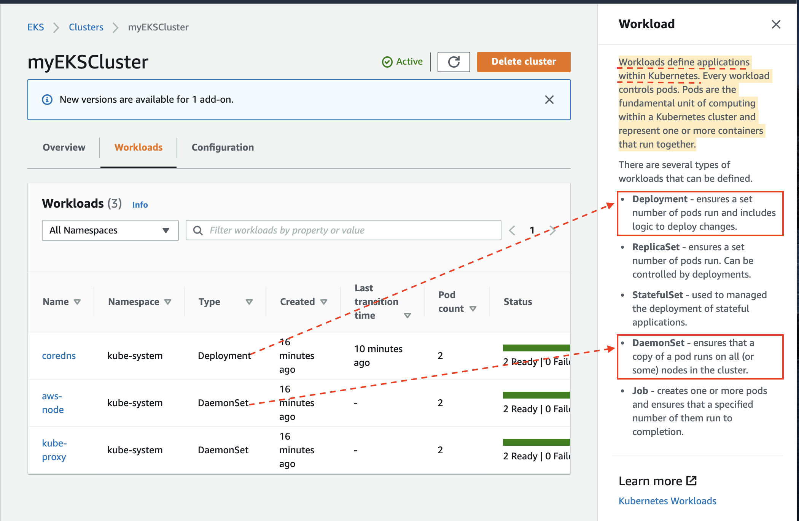

#### Part 4: Clean Up

- Delete the node group first.
  - See AWS's [managed node-group deletion instructions](https://docs.aws.amazon.com/eks/latest/userguide/delete-managed-node-group.html).
- Then delete the cluster.
  - See AWS's [cluster deletion instructions](https://docs.aws.amazon.com/eks/latest/userguide/delete-cluster.html).
- Deleting the custom IAM roles is optional; IAM itself has no charge, and removing the roles is not required to delete the cluster.
  - Keep a role if you plan to reuse it or want to retain it for learning, but remember that its permissions remain available to trusted entities that can assume it.
  - If a role was created only for this exercise and is no longer needed, first confirm that no other cluster or resource uses it, then delete it as cleanup.
- You have created a Kubernetes cluster using the web UI console.
- The following sections use `eksctl` and the AWS CLI to create an EKS cluster.

### Installing eksctl

- **`eksctl`** is the official command-line tool for creating and managing Amazon EKS clusters.
- `eksctl` is now an open-source project.
- `eksctl` uses AWS CloudFormation to provision the AWS resources that make up a cluster.
  - CloudFormation creates and manages AWS resources from a YAML or JSON template.
  - For a basic cluster, `eksctl` generates the template, so you do not need to write it yourself.
  - For a cluster with custom requirements, you can write a YAML configuration file and pass it to `eksctl`.
- A basic EKS cluster can include a VPC, subnets, worker-node groups, node machine images (AMIs), EC2 instance types, and a Kubernetes API endpoint.
  - A VPC is an isolated virtual network with an IP address range.
  - A subnet is a smaller IP range inside a VPC, assigned to one Availability Zone.
  - A node group is a group of worker machines (EC2 instances).
  - The AMI defines the node operating system, and the instance type defines its hardware capacity.
  - The Kubernetes API endpoint is the address used by tools such as kubectl to communicate with the cluster control plane.

#### Prerequisites and AWS credentials

- Install and configure AWS CLI before using `eksctl`. The AWS credentials and Region that work for AWS CLI are also used by `eksctl`. See [AWS CLI and Credentials](#aws-cli-and-credentials).
- If you use an IAM Identity Center (SSO) profile, sign in and select the profile in PowerShell. Replace **deployment-course** with your own profile name.

  ```powershell
  $env:PATH = "C:\Program Files\Amazon\AWSCLIV2;" + $env:PATH
  aws sso login --profile deployment-course
  $env:AWS_PROFILE = "deployment-course"
  aws sts get-caller-identity
  ```

- Setting **AWS_PROFILE** selects that profile for the current PowerShell session. Open a new session or set it again when needed.
- The selected AWS role needs permission to create the EKS, EC2, CloudFormation, and IAM resources required by the cluster.
- `eksctl` also needs an AWS IAM Authenticator command available in your PATH. Use **aws-iam-authenticator** or **aws eks get-token** from AWS CLI v2.
- Follow the [official AWS eksctl installation instructions](https://docs.aws.amazon.com/eks/latest/eksctl/installation.html). AWS recommends downloading official releases; third-party package managers are not maintained or supported by AWS.

#### Install on Windows with PowerShell

- Download the official release archive for your computer architecture.
  - Choose [AMD64/x86_64](https://github.com/eksctl-io/eksctl/releases/latest/download/eksctl_Windows_amd64.zip) for most Windows PCs.
  - Choose [ARM64](https://github.com/eksctl-io/eksctl/releases/latest/download/eksctl_Windows_arm64.zip) for Windows on ARM.
- Extract the archive to a folder in your PATH. The following example uses **%USERPROFILE%\bin** and adds it to your user PATH.

  ```powershell
  $arch = "amd64" # Change to "arm64" for Windows on ARM.
  $installDir = Join-Path $env:USERPROFILE "bin"
  $zip = Join-Path $env:TEMP "eksctl_Windows_$arch.zip"
  $url = "https://github.com/eksctl-io/eksctl/releases/latest/download/eksctl_Windows_$arch.zip"

  New-Item -ItemType Directory -Force -Path $installDir | Out-Null
  Invoke-WebRequest -Uri $url -OutFile $zip
  Expand-Archive -LiteralPath $zip -DestinationPath $installDir -Force

  $userPath = [Environment]::GetEnvironmentVariable("Path", "User")
  if (($userPath -split ";") -notcontains $installDir) {
      $newPath = if ($userPath) { "$userPath;$installDir" } else { $installDir }
      [Environment]::SetEnvironmentVariable("Path", $newPath, "User")
  }
  ```

- Optionally download the release checksum list and verify that the ZIP archive matches the official checksum. A result of **True** means the hashes match.

  ```powershell
  $checksums = Join-Path $env:TEMP "eksctl_checksums.txt"
  Invoke-WebRequest -Uri "https://github.com/eksctl-io/eksctl/releases/latest/download/eksctl_checksums.txt" -OutFile $checksums
  (Get-FileHash -Algorithm SHA256 $zip).Hash -eq ((Get-Content $checksums) -match "eksctl_Windows_$arch.zip" -split " ")[0]
  ```

- Close and reopen PowerShell so it loads the updated PATH, then verify the installation.

  ```powershell
  eksctl version
  Get-Command eksctl
  ```

#### Install on Linux

- Download the current Linux release, optionally verify its checksum, then install eksctl in **/usr/local/bin**.

  ```bash
  # Use arm64 instead of amd64 on ARM64 systems.
  ARCH=amd64
  PLATFORM="$(uname -s)_$ARCH"

  curl -sLO "https://github.com/eksctl-io/eksctl/releases/latest/download/eksctl_$PLATFORM.tar.gz"

  # Optional: verify the archive checksum.
  curl -sL "https://github.com/eksctl-io/eksctl/releases/latest/download/eksctl_checksums.txt" \
    | grep "$PLATFORM" | sha256sum --check

  tar -xzf "eksctl_$PLATFORM.tar.gz" -C /tmp
  sudo install -m 0755 /tmp/eksctl /usr/local/bin
  rm "eksctl_$PLATFORM.tar.gz" /tmp/eksctl
  ```

#### Install on macOS with Homebrew

- If Homebrew is not installed, follow the instructions at [brew.sh](https://brew.sh/).
- Use AWS’s current Homebrew tap to install eksctl.

  ```bash
  brew --version
  brew tap aws/tap
  brew install aws/tap/eksctl
  ```

- If Homebrew reports a permissions or ownership problem, follow its troubleshooting instructions for the specific path instead of recursively changing ownership of a broad system directory.

#### Create a basic cluster

- After installing eksctl and configuring AWS credentials, create a basic cluster with one command.

  ```bash
  eksctl create cluster
  ```

- By default, eksctl uses the AWS CLI's configured Region and creates the following:
  - A cluster with an automatically generated name.
  - One managed node group containing two **m5.large** worker nodes.
  - The official Amazon EKS machine image for the nodes.
  - A dedicated VPC and the network resources needed by the cluster.
- The **m5.large** instance type has 2 vCPUs, 8 GiB of memory, and up to 10 Gbps network bandwidth. See [EC2 instance types](https://aws.amazon.com/ec2/instance-types/).
- Cluster creation provisions AWS resources that incur charges while they exist, so choose the Region deliberately and delete the cluster after practice.
- You can specify the cluster name and node count explicitly.

  ```bash
  eksctl create cluster --name myCluster --nodes 4
  ```

#### Create a cluster from a YAML configuration

- A YAML configuration file lets you specify cluster settings without putting every option on the command line. This example follows the [console walkthrough](#creating-an-eks-cluster-via-web-ui-console): it uses `myEKSCluster` in `eu-central-1`, the existing VPC, and a managed node group with two `t3.micro` instances and 20-GiB disks.
- Replace the VPC and subnet ID placeholders with IDs from your account before running the command. Use the actual Availability Zone names shown for those subnets in your account, and select subnets in at least two AZs.

  ```yaml
  apiVersion: eksctl.io/v1alpha5
  kind: ClusterConfig

  metadata:
    name: myEKSCluster
    region: eu-central-1
    version: "1.37"

  vpc:
    id: "vpc-REPLACE_WITH_YOUR_VPC_ID"
    subnets:
      public:
        eu-central-1a:
          id: "subnet-REPLACE_WITH_SUBNET_ID_IN_1A"
        eu-central-1b:
          id: "subnet-REPLACE_WITH_SUBNET_ID_IN_1B"

  managedNodeGroups:
    - name: myNodeGroup
      instanceType: t3.micro
      volumeSize: 20
      minSize: 2
      maxSize: 2
      desiredCapacity: 2
  ```

- `apiVersion` and `kind` identify the document as an eksctl `ClusterConfig`.
- Under `metadata`, `name` sets the cluster name, `region` sets the AWS Region, and `version` selects the Kubernetes version. Choose a version offered by EKS in that Region.
- Under `vpc`, `id` selects the existing VPC. `subnets.public` maps each Availability Zone to a public subnet ID. The example uses two subnets in different AZs; replace both keys and IDs with the values from your VPC. Since these are public subnets and the node group does not enable private networking, the worker nodes use public subnets too.
- Each item under `managedNodeGroups` defines an EKS-managed worker group. `name` identifies it, `instanceType` chooses the EC2 hardware, and `volumeSize` sets each node's root disk in GiB. `minSize`, `maxSize`, and `desiredCapacity` set the group's minimum, maximum, and target node counts. All are `2` here, so the group targets two nodes and cannot scale beyond two.
- The `t3.micro` instance type matches the small console example, but has limited memory and may not be suitable for useful workloads. SSH settings are omitted, so this example does not enable remote SSH access.
- eksctl creates the cluster and node IAM roles through CloudFormation; the YAML therefore does not reuse the manually created `myEKSClusterRole` or `myEKSWorkerNodeRole` from the console steps. The active AWS credentials must be allowed to create the required resources.
- For the supported fields and schema, see the official [eksctl configuration-file schema](https://schema.eksctl.io/). For syntax and examples, see [creating clusters from configuration files](https://eksctl.io/usage/creating-and-managing-clusters/) and [configuring an existing VPC](https://eksctl.io/usage/vpc-configuration/).

  ```bash
  eksctl create cluster --config-file cluster.yaml
  ```

#### List and delete clusters

- List clusters in the Region configured for the active AWS profile.

  ```bash
  eksctl get cluster
  ```

- Get information about a named cluster in a specified Region.

  ```bash
  eksctl get cluster --name myCluster --region eu-central-1
  ```

- Delete an eksctl-created cluster when you no longer need it. Review and remove any additional resources you created separately.

  ```bash
  eksctl delete cluster --name myCluster --region eu-central-1
  ```

- eksctl has additional options, including minimum and maximum node-group sizes and SSH access to nodes. Autoscaling requires suitable autoscaling components and configuration.

### Installing kubectl

- `kubectl` (pronounced "cube control") is the command-line client for communicating with a Kubernetes cluster. You can use it to inspect cluster resources and manage workloads such as Deployments and Pods.
- Install a client version within one minor version of the Kubernetes cluster version. For example, kubectl `1.37` works with control planes `1.36`, `1.37`, and `1.38`.

#### Install kubectl on Windows

- In PowerShell, install using Windows Package Manager (`winget`):

  ```powershell
  winget install -e --id Kubernetes.kubectl
  ```

- Close and reopen PowerShell, then verify that kubectl is available:

  ```powershell
  kubectl version --client
  ```

- See the Kubernetes [Windows installation instructions](https://kubernetes.io/docs/tasks/tools/install-kubectl-windows/) for direct downloads and other package managers.

#### Install kubectl on Linux

- The following example installs kubectl `1.37.0` for an x86-64 Linux machine. Choose a version within one minor release of your cluster and use `arm64` in the URL for an ARM64 machine.

  ```bash
  KUBECTL_VERSION="v1.37.0"
  curl -LO "https://dl.k8s.io/release/${KUBECTL_VERSION}/bin/linux/amd64/kubectl"
  sudo install -o root -g root -m 0755 kubectl /usr/local/bin/kubectl
  kubectl version --client
  ```

- See the Kubernetes [Linux installation instructions](https://kubernetes.io/docs/tasks/tools/install-kubectl-linux/) for package-manager options and checksum verification.

#### Install kubectl on macOS

- Install with Homebrew:

  ```bash
  brew install kubectl
  kubectl version --client
  ```

- See the Kubernetes [macOS installation instructions](https://kubernetes.io/docs/tasks/tools/install-kubectl-macos/) for direct downloads and other package managers.

#### Configure kubectl to connect to EKS

- `kubectl` reads cluster connection settings from a **kubeconfig** file: `~/.kube/config`. For EKS, the AWS CLI can create or update this file and add a context for the cluster.
- First, sign in to the AWS IAM Identity Center profile configured earlier. Then update kubeconfig for the console-created cluster:

  ```powershell
  $env:PATH = "C:\Program Files\Amazon\AWSCLIV2;" + $env:PATH
  aws sso login --profile deployment-course
  aws eks update-kubeconfig --region eu-central-1 --name myEKSCluster --profile deployment-course --alias myEKSCluster
  ```

- The kubeconfig is normally stored at `~/.kube/config` (`$HOME\.kube\config` on Windows). `update-kubeconfig` merges the cluster entry into this file and makes it the current context. Clusters created with `eksctl` normally have their kubeconfig entry added during cluster creation.
- Confirm the active AWS identity and kubectl context:

  ```powershell
  aws sts get-caller-identity --profile deployment-course
  kubectl config get-contexts
  kubectl config current-context
  ```

- A **context** combines a cluster, user credentials, and optionally a namespace (logical partition: `dev`, `prod`, etc.). `kubectl config get-contexts` lists clusters configured in kubeconfig; it does not discover every EKS cluster in your AWS account. To list EKS clusters in AWS, use:

  ```powershell
  aws eks list-clusters --region eu-central-1 --profile deployment-course
  ```

- Switch to another context by using its name from `kubectl config get-contexts`:

  ```powershell
  kubectl config use-context myEKSCluster
  ```

#### Inspect clusters, nodes, and Pods

- A **node** is a worker machine in the cluster. A **Pod** is the Kubernetes unit that runs one or more containers.
- Check the API server connection and list worker nodes:

  ```bash
  kubectl cluster-info
  kubectl get nodes -o wide
  ```

- List Pods in every namespace, or list Pods in a particular namespace:

  ```bash
  kubectl get pods --all-namespaces
  kubectl get pods --namespace default -o wide
  ```

- List common resources in the `default` namespace, inspect a Pod, and view its logs. Replace the example names with resources in your cluster:

  ```bash
  kubectl get deployments,services,pods --namespace default
  kubectl describe pod <pod-name> --namespace default
  kubectl logs <pod-name> --namespace default
  ```

#### Open a shell inside a Pod

- `kubectl exec` runs a command inside a container in a Pod. Use `sh` if the container image includes it; minimal images may not contain a shell.

  ```bash
  kubectl exec -it <pod-name> --namespace default -- sh
  ```

- Type `exit` to leave the shell. This enters a container in the Pod; it does not open an SSH session to the EC2 worker node.
- For additional commands and options, see the Kubernetes [kubectl reference](https://kubernetes.io/docs/reference/kubectl/) and AWS [EKS kubeconfig instructions](https://docs.aws.amazon.com/eks/latest/userguide/create-kubeconfig.html).

### Creating an EKS Cluster via eksctl and AWS CLI

- **eksctl** is a higher-level command-line tool for provisioning and managing EKS clusters. It uses AWS CloudFormation to create the cluster and associated AWS resources, including its VPC and a managed node group.
- The three command-line tools have different roles:
  - The **AWS CLI** authenticates to AWS and can call AWS service APIs directly.
  - **eksctl** creates and manages the EKS cluster and its AWS infrastructure.
  - **kubectl** talks to the Kubernetes API to inspect and manage resources inside a running cluster, such as nodes and Pods.
- The command below creates a new cluster and a managed node group with two **t3.medium** instances in **eu-central-1**. It creates its own VPC; it does not reuse the VPC selected in the console walkthrough. To use an existing VPC, use the YAML example in [Create a cluster from a YAML configuration](#create-a-cluster-from-a-yaml-configuration).

#### Check the tools and AWS credentials

- Use AWS CLI v2.12.3 or later and eksctl version **0.215.0 or later**. Check your installed versions; kubectl should be within one minor version of the cluster's Kubernetes version.

  ```powershell
  aws --version
  eksctl version
  kubectl version --client
  ```
- This guide uses the IAM Identity Center profile **deployment-course**. Sign in and select the profile for the current PowerShell session so eksctl uses the same AWS identity as the AWS CLI:

  ```powershell
  $env:PATH = "C:\Program Files\Amazon\AWSCLIV2;" + $env:PATH
  aws sso login --profile deployment-course
  $env:AWS_PROFILE = "deployment-course"
  aws sts get-caller-identity
  ```

- In Bash, set the profile in the current shell this way:

  ```bash
  export AWS_PROFILE=deployment-course
  aws sso login --profile "$AWS_PROFILE"
  aws sts get-caller-identity
  ```

- The AWS identity needs permission to create the required EKS, EC2, IAM, and CloudFormation resources and permission to access the cluster afterward.
- EKS currently offers Kubernetes version **1.37** in standard support. Check the versions offered in your chosen Region before using the version option; change the example if necessary.

  ```powershell
  aws eks describe-cluster-versions --region eu-central-1 --query "clusterVersions[].clusterVersion" --output table
  ```

#### Create the cluster

- Running the command without options uses the Region configured for the AWS CLI profile and creates a managed node group with two **m5.large** instances. The named command below makes the Region and cluster settings explicit.

  ```bash
  eksctl create cluster
  ```
- Create a cluster named **eksctl-demo** with two On-Demand worker nodes. Choose a cluster name and Kubernetes version that are available in your AWS account and Region.

  ```bash
  eksctl create cluster --name eksctl-demo --region eu-central-1 --version 1.37 --nodes 2 --instance-types=t3.micro --profile deployment-course
  ```

- Cluster provisioning takes several minutes. By default, eksctl creates a managed node group and writes a context for the cluster to kubeconfig, usually **~/.kube/config**. You do not need to run **aws eks update-kubeconfig** for a cluster just created by eksctl.
- eksctl creates CloudFormation stacks for the cluster and node group. You can follow their progress in the [CloudFormation console for eu-central-1](https://eu-central-1.console.aws.amazon.com/cloudformation/home?region=eu-central-1#/stacks). Make sure the console is set to the same Region as the command.

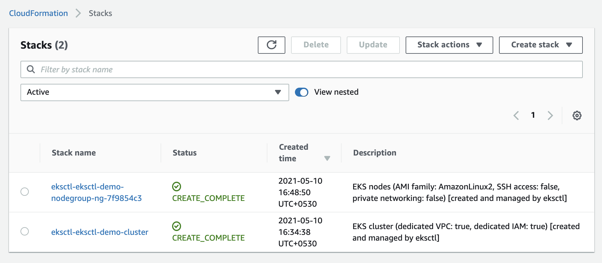

- Usually, the `eksctl create cluster` command above automatically creates a managed node group. If you need to create node group explicitly, you can use the `eksctl create nodegroup` command as shown below.

  ```bash
  eksctl create nodegroup --cluster eksctl-demo --region eu-central-1 --name eksctl-demo-ng --managed --node-type t3.micro --nodes 2
  ```

#### Check the cluster and worker nodes

- Check eksctl's view of the cluster, then use kubectl to confirm that the Kubernetes API is reachable and both nodes are ready:

  ```powershell
  eksctl get cluster --name eksctl-demo --region eu-central-1
  # If this fails, see below
  kubectl cluster-info
  kubectl get nodes -o wide
  ```

- Usually, when we create a cluster with eksctl, it automatically updates the kubeconfig file with the new cluster's context. However, if you encounter issues accessing the cluster, you can manually update the kubeconfig as shown below.

  ```powershell
  #$env:PATH = "C:\Program Files\Amazon\AWSCLIV2;" + $env:PATH
  #$env:AWS_PROFILE = "deployment-course"
  aws sso login --profile deployment-course
  aws eks update-kubeconfig --region eu-central-1 --name eksctl-demo --profile deployment-course --alias eksctl-demo
  kubectl config current-context  # eksctl-demo
  kubectl cluster-info
  kubectl get nodes -o wide
  ```

- In CloudFormation, the cluster stack's **Template** tab shows the infrastructure template eksctl submitted. The screenshot is from the course recording, so the current console layout may differ.

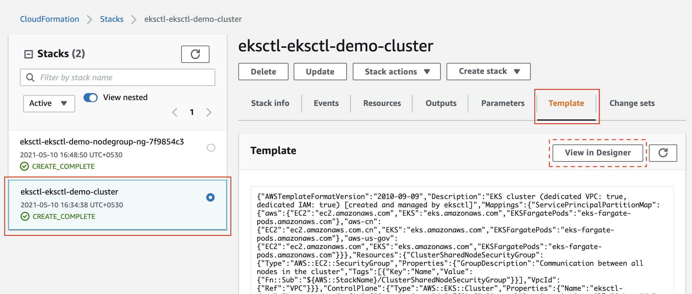

#### Delete the cluster when finished

- EKS clusters, EC2 worker nodes, storage, and networking resources can incur charges while they exist. Delete the test cluster when you no longer need it; the wait option makes eksctl wait for deletion to complete and report errors.

  ```bash
  eksctl delete cluster --name eksctl-demo --region eu-central-1 --wait --profile=deployment-course
  ```

- eksctl removes resources it manages for this cluster. Check the AWS console afterward for resources you created separately or attached to the cluster, since those may need separate cleanup.
- Prefer deleting an eksctl-created cluster with eksctl. CloudFormation is useful for viewing progress and diagnosing stacks; manually deleting a stack can leave the cluster in a partially deleted state if other resources still depend on it.
- For command details, see the official [eksctl cluster management guide](https://eksctl.io/usage/creating-and-managing-clusters/), AWS's [EKS cluster creation guide](https://docs.aws.amazon.com/eks/latest/userguide/create-cluster.html), and the current [EKS Kubernetes version lifecycle](https://docs.aws.amazon.com/eks/latest/userguide/kubernetes-versions.html).

## Deployment Using CI/CD: CloudFormation + CodeBuild + CodePipeline

This section uses the repository [cd0157-Server-Deployment-and-Containerization](https://github.com/udacity/cd0157-Server-Deployment-and-Containerization) clones as submodule into [`lab/udacity_server_deployment_exercises/`](./lab/udacity_server_deployment_exercises/).

### Deploy a Flask Application Manually

- This exercise deploys the submodule's Hello World Flask app to the EKS cluster created in the previous sections.
- The workflow is: build a container image, push it to Docker Hub, point the Kubernetes Deployment at that image, verify the Pods, and expose the app through a Service.
- The detailed steps below assume kubectl is connected to the intended EKS cluster and its worker nodes are Ready; see [Installing kubectl](#installing-kubectl) and [Creating an EKS Cluster via eksctl and AWS CLI](#creating-an-eks-cluster-via-eksctl-and-aws-cli) for those setup steps.

#### Prepare the Docker Hub repository and exercise files

- Create a **public** [Docker Hub](https://hub.docker.com/) repository named **simple-flask**. A public image can be pulled by EKS without adding registry credentials to the cluster.
- This exercise uses your Docker Hub repository, **<username>/simple-flask**. The manifest and commands below use the versioned image tag **v1**.

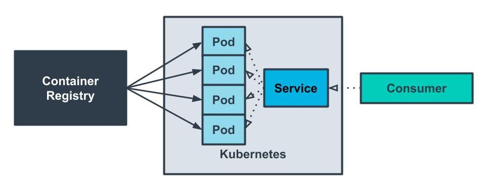

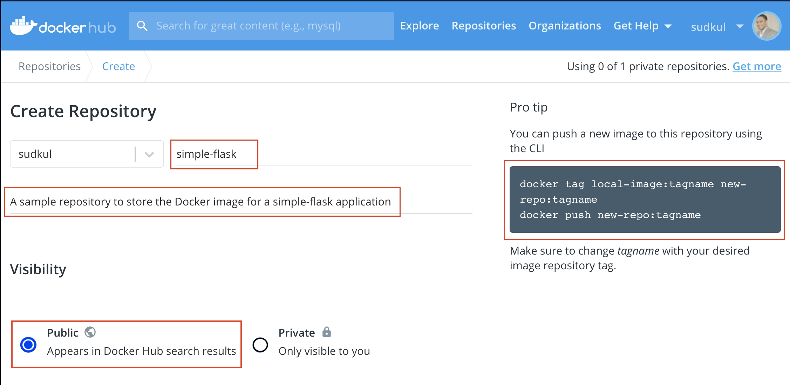

- The Udacity exercise repository was added earlier as a Git submodule. From the **01_ServerDeployment** directory, open the Flask deployment example inside it:

  ```powershell
  cd .\lab\udacity_server_deployment_exercises\examples\Deploy_Flask_App
  ```

- The folder contains
  - [app.py](./lab/udacity_server_deployment_exercises/examples/Deploy_Flask_App/app.py),
  - [Dockerfile](./lab/udacity_server_deployment_exercises/examples/Deploy_Flask_App/Dockerfile),
  - and [deployment.yml](./lab/udacity_server_deployment_exercises/examples/Deploy_Flask_App/deployment.yml).
- The Flask app listens on port **8080**, and the Kubernetes manifest creates three replicas.
- The exercise Dockerfile now uses **python:3.13-slim**, consistent with the earlier Dockerfile exercise. The sample also enables Flask debug mode and is for learning, not production.

#### Build and publish the image

- Build the image with the versioned tag used by the Kubernetes manifest:

  ```powershell
  docker build --pull -t <username>/simple-flask:v1 .
  docker image ls
  ```

- Sign in to Docker Hub and push the tagged image. Docker prompts you to complete authentication; do not put your password or access token in the command:

  ```powershell
  docker login --username <username>
  docker push <username>/simple-flask:v1
  ```

- If the local image has a different name, retag it before pushing:

  ```powershell
  docker tag <local-image-name>:<tag-name> <username>/simple-flask:v1
  ```

- Confirm that Docker Hub shows the **v1** tag before deploying it.

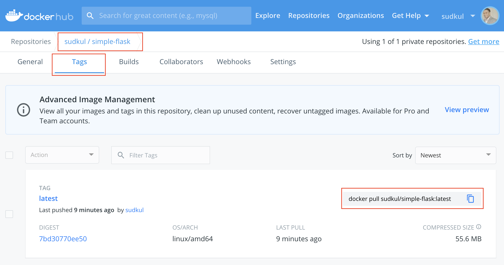

#### Configure and apply the Kubernetes Deployment

- [deployment.yml](./lab/udacity_server_deployment_exercises/examples/Deploy_Flask_App/deployment.yml) is configured to use the same image tag you just pushed:

  ```yaml
  image: <username>/simple-flask:v1
  ```

- The Deployment describes the Pods that run the app and maintains the requested replicas. Its container port is **8080**, matching the Flask app. Use enough worker-node capacity for all three replicas; if Pods remain Pending, inspect their events and adjust the node capacity or replica count.
- Apply the manifest and wait until Kubernetes reports the rollout complete:

  ```powershell
  # Login
  #$env:PATH = "C:\Program Files\Amazon\AWSCLIV2;" + $env:PATH
  #$env:AWS_PROFILE = "deployment-course"
  aws sso login --profile deployment-course

  # Create Cluster + Nodegroup (this takes some minutes)
  # Note: select t3.medium, as t3.micro may not provide enough resources for all replicas!
  eksctl create cluster --name eksctl-demo --region eu-central-1 --version 1.37 --nodes 2 --instance-types=t3.medium --profile deployment-course
  aws eks update-kubeconfig --region eu-central-1 --name eksctl-demo --profile deployment-course
  kubectl config current-context
  kubectl get nodes -o wide

  # Deploy (apply) to the Kubernetes cluster
  kubectl apply -f deployment.yml  # deployment.apps/simple-flask-deployment created
  kubectl rollout status deployment/simple-flask-deployment  # deployment "simple-flask-deployment" successfully rolled out
  kubectl get deployment,pods,nodes -o wide
  ```

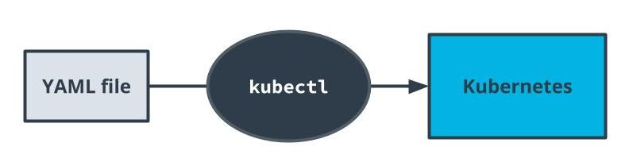

- Check that the Pods use your image and reach **Running** and **Ready**. If a Pod shows **ErrImagePull** or **ImagePullBackOff**, verify the image name and tag in the manifest and confirm that the repository is public:

  ```powershell
  kubectl get pods -l app=simple-flask -o wide
  kubectl describe pods -l app=simple-flask
  kubectl logs deployment/simple-flask-deployment
  ```

#### Understanding the Deployment YAML

The file [`deployment.yml`](./lab/udacity_server_deployment_exercises/examples/Deploy_Flask_App/deployment.yml) is a **manifest**: a YAML description of the Kubernetes object you want the cluster to maintain. `kubectl apply -f deployment.yml` submits this desired state to the Kubernetes API; controllers then create or change resources to match it.

```yaml
apiVersion: apps/v1
kind: Deployment
metadata:
  name: simple-flask-deployment
  labels:
    app: simple-flask
spec:
  replicas: 3
  selector:
    matchLabels:
      app: simple-flask
  strategy:
    type: RollingUpdate
    rollingUpdate:
      maxUnavailable: 2
      maxSurge: 2
  template:
    metadata:
      labels:
        app: simple-flask
    spec:
      containers:
      - name: simple-flask
        image: msagardia/simple-flask:v1
        securityContext:
          privileged: false
          readOnlyRootFilesystem: false
          allowPrivilegeEscalation: false
        ports:
          - containerPort: 8080

```

**Overview of the structure:**

- `apiVersion`, `kind`, and `metadata` identify and describe the object. The top-level `spec` describes the desired Deployment. Inside it, `selector` tells the Deployment which Pods it manages, `strategy` describes how updates happen, and `template` describes the Pods it should create.
- A **Deployment** is the controller that keeps the requested number of app copies running. Here, `replicas: 3` means three Pods, each running the same Flask container; it does not mean three nodes. The **nodes** are the worker machines that provide compute capacity, and the scheduler places those Pods on available nodes. In the current cluster, two nodes run the three replicas, with two Pods on one node and one on the other.
- This manifest creates the Deployment and Pods, but it does **not** create a load balancer or a public address. With `kubectl port-forward deployment/simple-flask-deployment 8080:8080` (see below), `kubectl` chooses one Pod for that forwarding session, so requests through that session go to that Pod; it does not balance requests across all three replicas. If that Pod stops, the forwarding session may fail, and restarting it can select another Pod.
- To distribute requests among the ready replicas, expose the Deployment through a Kubernetes **Service**. A `ClusterIP` Service is reachable inside the cluster; a `LoadBalancer` Service in EKS asks AWS to create an external load balancer that routes incoming requests to ready Pods. The Service and load balancer are separate resources from this Deployment manifest.
- The nesting is meaningful: `template.metadata` and `template.spec` describe each Pod, while the top-level `metadata` and `spec` describe the Deployment. The Pod template's labels must match the Deployment selector.

**Top-level fields and Deployment settings:**

- `apiVersion: apps/v1` selects the stable Kubernetes API version that defines the Deployment object's fields.
- `kind: Deployment` tells Kubernetes what type of object this manifest describes. A Deployment manages a set of matching Pods and replaces them when they fail or when the Pod template changes.
- `metadata.name: simple-flask-deployment` gives this Deployment its name within its Kubernetes namespace. Commands such as `kubectl rollout status deployment/simple-flask-deployment` refer to it by this name.
- `metadata.labels.app: simple-flask` attaches a label to the Deployment object itself. Labels are key/value tags that help organize and select Kubernetes objects; this label does not automatically label the Pods.
- `spec.replicas: 3` asks Kubernetes to keep three matching Pods running. This is a desired count, and the cluster needs enough node capacity to schedule them.
- `spec.selector.matchLabels.app: simple-flask` defines which Pods this Deployment manages. It must match the labels in the Pod template below; Kubernetes uses this selector to associate the Deployment with its Pods.
- `spec.strategy.type: RollingUpdate` asks Kubernetes to replace Pods gradually when the Pod template changes, instead of stopping all old Pods before creating new ones.
- `spec.strategy.rollingUpdate.maxUnavailable: 2` allows up to two desired replicas to be unavailable during an update. With three desired replicas, this can temporarily leave only one available while the rollout proceeds.
- `spec.strategy.rollingUpdate.maxSurge: 2` allows Kubernetes to create up to two temporary Pods above the desired replica count during an update. These settings trade availability and temporary resource use; the nodes need room to schedule the extra Pods. The values here are absolute Pod counts, not percentages.

**Pod template and container settings:**

- `spec.template.metadata.labels.app: simple-flask` labels every Pod created from this template. This value matches `spec.selector.matchLabels.app`, which is required for the Deployment to manage those Pods.
- `spec.template.spec.containers` is the list of containers that each Pod runs. This example has one container; a Pod can contain more than one when containers need to work closely together.
- `containers[].name: simple-flask` names the container within each Pod. Kubernetes uses this name in container-specific commands and status output.
- `containers[].image: msagardia/simple-flask:v1` tells the container runtime which image to download and run. It identifies the Docker Hub repository and the `v1` tag.
- `securityContext.privileged: false` keeps the container from running in privileged mode, which would grant it broad access to the host. This is the safer default for an application container.
- `securityContext.readOnlyRootFilesystem: false` allows the container to write to its root filesystem. This is convenient for this exercise, but production containers should use a read-only root filesystem when the application supports it.
- `securityContext.allowPrivilegeEscalation: false` prevents processes in the container from gaining more privileges than their parent process.
- `ports[].containerPort: 8080` documents that the application listens on port `8080` inside the container. It does not publish the port outside the Pod; use a Kubernetes Service or `kubectl port-forward` to reach the application.

These settings explain why the earlier three-replica rollout remained Pending on two `t3.micro` nodes: the desired Pods plus Kubernetes system Pods exceeded the nodes' pod capacity. Reducing `replicas`, or adding sufficiently sized node capacity, lets the scheduler place the application Pods.

For the authoritative field definitions, see the Kubernetes documentation for [Deployments](https://kubernetes.io/docs/concepts/workloads/controllers/deployment/) and [container security context](https://kubernetes.io/docs/tasks/configure-pod-container/security-context/).

#### Access the application

- A Deployment creates Pods but does not by itself provide a stable client-facing address. For a quick local test without creating an AWS load balancer, forward a local port to the Deployment:

  ```powershell
  kubectl port-forward deployment/simple-flask-deployment 8080:8080
  ```

- While port-forward is running, open **http://localhost:8080/** in a browser. Press **Ctrl+C** to stop forwarding.

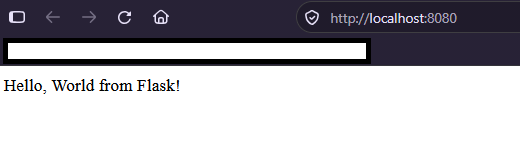

- To create an AWS load balancer for external access, expose the Deployment with a Service. This AWS resource can incur charges while it exists:

  ```powershell
  kubectl expose deployment simple-flask-deployment --name=simple-flask-service --type=LoadBalancer --port=80 --target-port=8080
  kubectl get service simple-flask-service --watch
  # Get the value of the EXTERNAL-IP field for the load balancer
  ```

- Wait for the Service's **EXTERNAL-IP** field to show a hostname instead of **pending**. Open `http://YOUR_LOAD_BALANCER_HOSTNAME/` in a browser; the Service listens on port **80** and forwards traffic to the app on port **8080**. Press **Ctrl+C** to stop watching Services.
- The course recording uses port **8080** for the external Service too. This example uses the standard web port **80**, so the hostname URL does not need **:8080**.

#### Troubleshoot and clean up

- If Pods are not Ready, inspect their status, events, and logs:

  ```powershell
  kubectl get pods -o wide
  kubectl describe pods -l app=simple-flask
  kubectl get events --sort-by=.metadata.creationTimestamp
  ```

- If no nodes appear, confirm the EKS cluster has a node group and that its EC2 worker nodes joined the cluster. The earlier EKS section covers adding and checking worker nodes.
- Delete the Service first so Kubernetes can release the AWS load balancer, then delete the Deployment:

  ```powershell
  kubectl delete service simple-flask-service
  kubectl delete -f deployment.yml
  ```

- If you are finished with the cluster, follow the cluster cleanup instructions in [Creating an EKS Cluster via eksctl and AWS CLI](#creating-an-eks-cluster-via-eksctl-and-aws-cli); keep the cluster if you will use it in the next lesson.
- For more kubectl commands, see the Kubernetes [kubectl cheat sheet](https://kubernetes.io/docs/reference/kubectl/cheatsheet/) and [kubectl reference](https://kubernetes.io/docs/reference/kubectl/).

  ```powershell
  eksctl delete cluster --name eksctl-demo --region eu-central-1 --wait --profile=deployment-course
  ```


## Project: Deploy Your Flask App to Kubernetes Using EKS

:construction:
